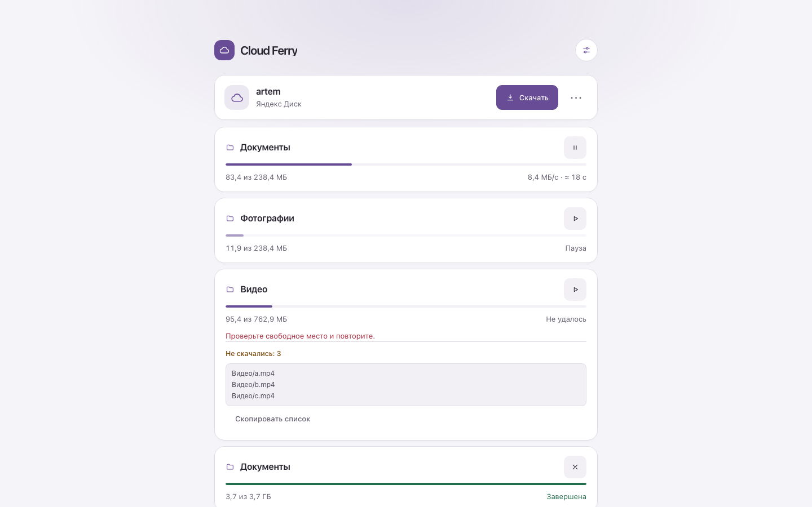

# Cloud Ferry

## About

Cloud Ferry скачивает файлы с Яндекс Диска на ваш сервер Umbrel: весь Диск
или выбранные папки и отдельные файлы. По умолчанию файлы попадают в
`/downloads` — папку Downloads в Umbrel.

Приложение только читает облако и добавляет файлы на сервер: в Яндекс Диске
ничего не удаляется и не изменяется, обратно на Диск ничего не загружается.

_Главный экран: кнопка «Скачать», карточки и прогресс скачиваний._

## Возможности

- Весь Диск или выбранные папки и отдельные файлы: до 20 папок и 100 файлов
  за одно скачивание.
- Выбор и проверка в одном окне: «Что скачать» → «Перед скачиванием»; папку
  на сервере и источник можно изменить кнопкой «Изменить».
- До запуска считаются объём и свободное место; если места не хватает,
  кнопка «Скачать» недоступна.
- Главный экран: карточки скачиваний с прогрессом, скоростью и остатком
  времени; «Приостановить» и «Продолжить».
- Папки, которые уже есть на сервере, помечаются «Есть на сервере»; их
  показывает переключатель «Показать папки на сервере».
- Панель «Настройки»: логин, способ входа, доступ, занятое место на Яндекс
  Диске и свободное на Umbrel. Светлая и тёмная тема, мобильный экран.

## Установка

1. Umbrel → App Store → ⋮ → Community App Stores → Add и добавьте
   `https://github.com/Chikurov/cloud-ferry`.
2. Установите Cloud Ferry и откройте приложение.
3. Нажмите «Подключить диск», укажите пароль приложения или токен, затем
   нажмите «Скачать» и выберите файлы.

## Требования

- Umbrel с umbrelOS 2.0+.
- Аккаунт Яндекс Диска.

## Ограничения

- Один аккаунт Яндекс Диска.
- Альбомы «Фото» и история версий не скачиваются.
- Недокачанный файл после паузы или перезапуска скачивается заново; уже
  скачанные файлы повторно не скачиваются.
- Большие папки показываются частично: в одной папке видно до 500 подпапок
  и до 200 файлов.
- Оценку объёма нельзя отменить на сервере: после ухода со шага она может
  идти до 10 минут.

## Документация

- [Руководство пользователя](docs/USER-GUIDE.md)
- [Сборка и установка](INSTALL.md)
- [Устройство и безопасность](docs/ARCHITECTURE.md)

## Лицензия

MIT — см. [LICENSE](LICENSE).
