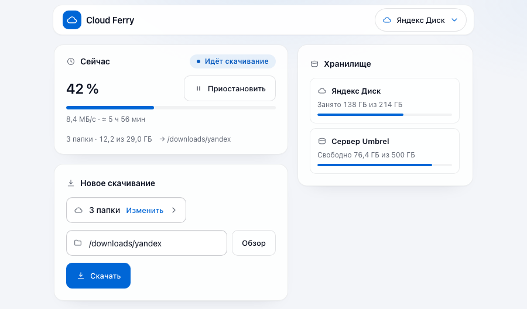
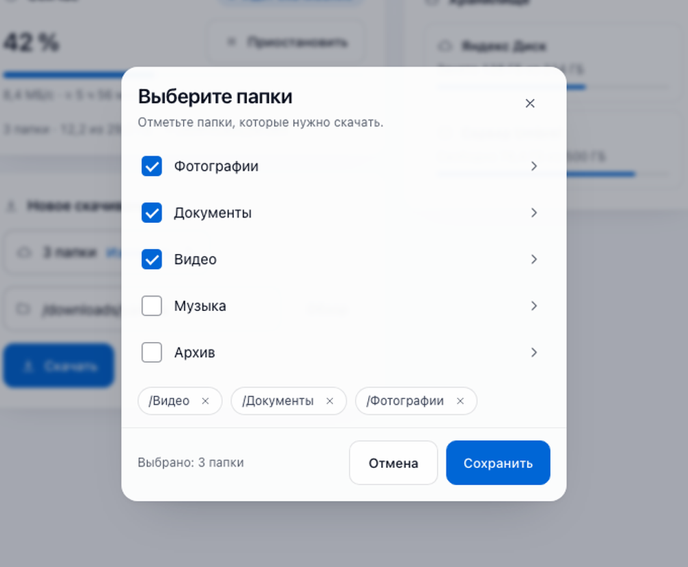

# Cloud Ferry

Скачивает файлы с Яндекс Диска на домашний сервер Umbrel: весь Диск или выбранные папки.

## Установка

1. Umbrel → App Store → ⋮ → Community App Stores → Add → `https://github.com/Chikurov/cloud-ferry`
2. Установите Cloud Ferry и откройте приложение.
3. Подключите Яндекс Диск и запустите скачивание.

## Возможности

- Весь Диск или выбранные папки — до 20 за раз.
- Прогресс, скорость и остаток времени; пауза и продолжение.
- Занятое место в облаке и свободное на сервере.
- Создание папки на сервере прямо в окне выбора.
- Подключение паролем приложения, OAuth-приложением или готовым токеном.
- Ничего не удаляет: только добавляет и обновляет файлы.

## Выбор папок

Отметьте нужные папки в дереве Диска — вложенность сохраняется, выбрать можно до 20 папок.

## Папка на сервере

Куда скачивать, выбирается на сервере. Если нужной папки ещё нет, создайте её прямо в окне выбора: за раз создаётся одна папка внутри уже открытой, без вложенных уровней. За пределы папок, разрешённых при установке, приложение не выходит.

## На телефоне

Интерфейс подстраивается под ширину экрана: те же карточки, кнопки и прогресс.

## Ограничения

- Один аккаунт Яндекс Диска.
- Недокачанный после перезапуска файл скачивается заново.
- Альбомы «Фото» и история версий не скачиваются.

## Лицензия

MIT. Сборка, публикация и откат — в [INSTALL.md](INSTALL.md).
