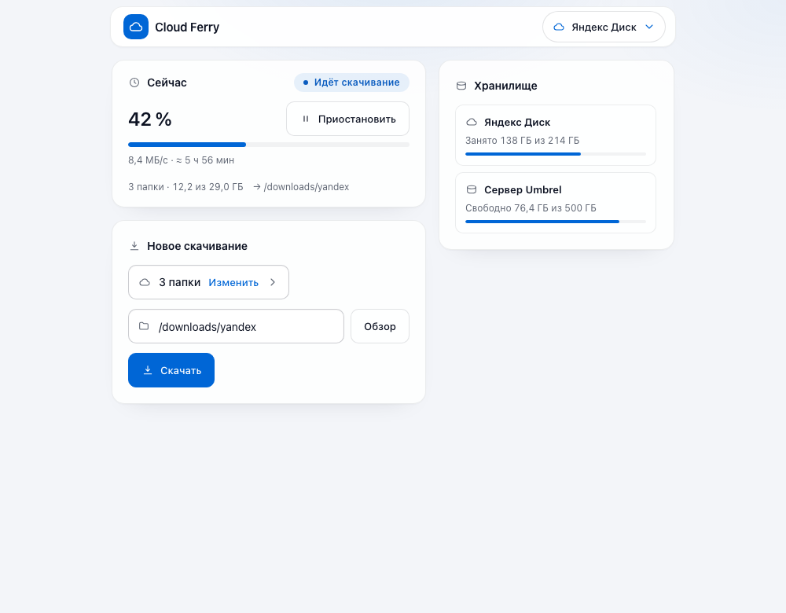

# Cloud Ferry

Скачивает файлы с Яндекс Диска на ваш домашний сервер Umbrel.

## Установка

1. Umbrel → App Store → ⋮ → Community App Stores → Add → `https://github.com/Chikurov/cloud-ferry`
2. Установите Cloud Ferry и откройте приложение.
3. Подключите Яндекс Диск и запустите скачивание.

Подробности, сборка образа и откат — в [INSTALL.md](INSTALL.md).

## Возможности

- Весь Диск или выбранные папки — до 20 за раз.
- Прогресс, скорость, остаток времени; пауза и продолжение.
- Занятое место в облаке и свободное на сервере.
- Ничего не удаляет: только добавляет и обновляет файлы.

## Подключение Яндекса

Пароль приложения (нужен Яндекс 360), своё OAuth-приложение или готовый токен. Для пароля приложения подождите 2–3 часа после создания. Не используйте `client_id` rclone — Яндекс отозвал у него доступ.

## Ограничения

- Один аккаунт Яндекс Диска.
- Недокачанный файл после перезапуска скачивается заново.
- Альбомы «Фото» и история версий не скачиваются.

## Лицензия

MIT.
