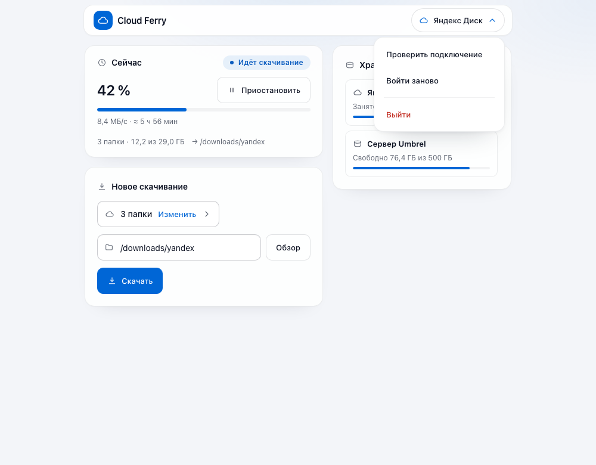
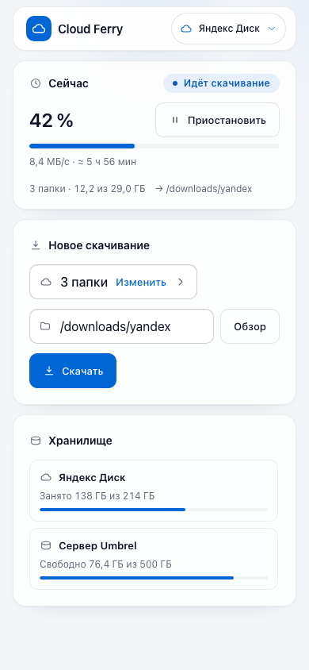
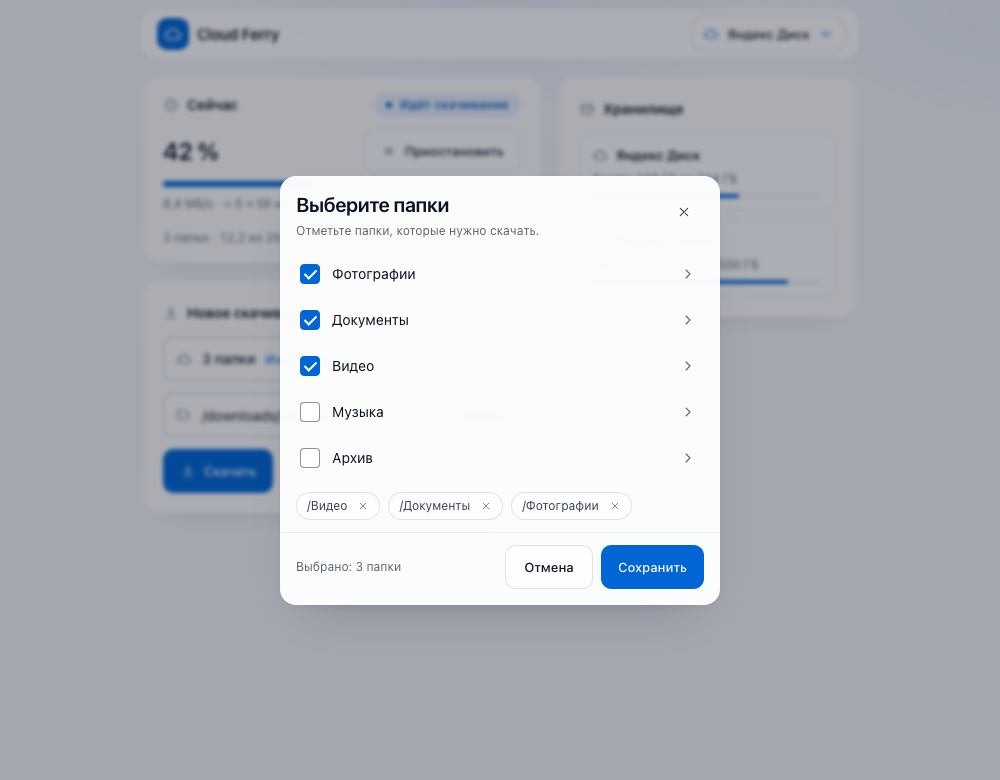

# Cloud Ferry

Приложение для umbrelOS: скачивает файлы из облачных хранилищ прямо на ваш
домашний сервер. Первый поддерживаемый провайдер — Яндекс Диск (два способа
подключения), движок скачивания — [rclone](https://rclone.org) (MIT).

Статус: **0.1.0, скелет**. Работает подключение WebDAV/OAuth-токена, запуск
копирования (всё облако или отмеченные папки), прогресс, остановка/продолжение,
проверка целостности, виджет на домашнем экране Umbrel. Сейчас поддержан один аккаунт Яндекс Диска: подключение
нового заменяет текущий, мультиаккаунт — следующая итерация. Нет также
расписаний, мастера создания OAuth-приложения, i18n.


Кадры финального набора — в [docs/final3/](docs/final3/), машинный отчёт проверок — в [audit-report.json](docs/final3/audit-report.json).

Образ пока не опубликован: сборка, публикация в GHCR, подстановка digest и
установка из community app store описаны в [INSTALL.md](INSTALL.md).

## Зачем

Штатный `Files → Cloud` в umbrelOS 2.0 построен на rclone, но список
провайдеров захардкожен (Google Drive, Dropbox, OneDrive, iCloud, WebDAV), а
сам umbrelOS распространяется под PolyForm Noncommercial. Яндекса там нет и не
появится без решения мейнтейнеров. Cloud Ferry закрывает этот пробел и
добавляет то, чего нет ни у CLI, ни у AList: мастер, очередь, прогресс,
список ошибок и отчёт о сверке.

## Архитектура

```
браузер ──► app_proxy (логин Umbrel) ──► api (Go, :3000)
                                          │  unix-сокет, allowlist методов
                                          ▼
                                        rclone rcd ──► Яндекс / WebDAV
                                          │
                                          ▼
                                   /downloads или /destination
```

Два контейнера:

- `api` — этот репозиторий: UI, REST, состояние в SQLite-подобном JSON-файле,
  планировщик и поллинг `core/stats`.
- `rclone` — официальный образ `rclone/rclone`, режим `rcd`, доступ только
  через unix-сокет внутри пода.

Папка назначения смонтирована в оба контейнера по одному и тому же пути
(`/downloads` и, в Umbrel, `/destination`): `api` читает свободное место и
проверяет пути, `rclone` пишет файлы. Если смонтировать папку только в `api`,
rclone сохранит файлы в слой контейнера, и они пропадут при его пересоздании.

**Модель безопасности.** rc-API rclone эквивалентен shell-доступу: через него
можно запускать команды и читать конфиг с токенами. Поэтому:

- сокет не публикуется ни в LAN, ни в интернет, у него права `0600`;
- браузер никогда не обращается к rclone напрямую — только к типизированным
  эндпоинтам нашего API;
- в клиенте rclone зашит allowlist методов (`internal/rc/methods.go`):
  `core/command`, `config/dump`, `config/setpath`, `operations/getfile`,
  `serve/*`, `mount/*`, `debug/*` отсекаются до отправки;
- токены облака не выводятся из `APP_SEED`, не попадают в compose-переменные,
  логи и бэкапы (`backupIgnore` исключает `rclone.conf`);
- интерфейс всегда отправляет `mode=copy`: приложение только добавляет
  новые и обновляет существующие файлы и ничего не удаляет — ни в облаке,
  ни на сервере. Синхронизация с удалением (`sync`) остаётся возможностью
  API и темой будущей итерации; в интерфейсе переключателя режима нет, и UI
  не отправляет `sync` ни в одном сценарии.

## Проверка на реальном Umbrel (без App Store)

Пока пакет не опубликован, проще собрать образ на самом сервере и запустить
через Docker Compose: см. [deploy/standalone/README.md](deploy/standalone/README.md).
В режиме проверки приложение защищено логином и паролем (`CF_BASIC_*`), потому
что порт слушается в локальной сети.

```bash
rsync -av --exclude .gocache --exclude bin cloud-ferry/ umbrel@umbrel.local:/home/umbrel/cloud-ferry-src/
ssh umbrel@umbrel.local
cd ~/cloud-ferry-src/deploy/standalone
mkdir -p ~/cloud-ferry/{state,run,rclone,cache} ~/umbrel/home/YandexDisk
cp .env.example .env && nano .env
docker compose up -d --build
```

Интерфейс: `http://umbrel.local:8741`. Оба контейнера должны стать
`healthy` (`docker compose ps`); `prepare`-сервис один раз удаляет stale
`*.sock`, чтобы rclone не падал с `address already in use` после грязной
остановки.

## Установка на Umbrel (community app store)

Полная пошаговая инструкция — [INSTALL.md](INSTALL.md): сборка, публикация в
GHCR, подстановка digest, добавление store, smoke-тест и откат. Кратко:

1. Требования: **Go 1.24+** (только для локальных проверок), **umbrelOS 2.0+**
   (`manifestVersion: "2.0"`), свободный порт `8741`, публичный GitHub-репозиторий.
2. Подставьте свой логин (меняет `exports.sh` и ссылки в манифесте):

   ```bash
   make set-owner OWNER=ВАШ_АККАУНТ
   ```

3. Соберите и опубликуйте multi-arch образ (`linux/amd64` + `linux/arm64`) в
   GHCR. Тег образа — **без ведущей `v`**: git-тег `v0.1.0` → образ
   `ghcr.io/ВАШ_АККАУНТ/cloud-ferry:0.1.0` → `version` в манифесте `"0.1.0"`.

   ```bash
   make docker-push           # или push git-тега v0.1.0: workflow соберёт сам
   make digest                # индекс-дайджест манифест-листа
   make pin-digest DIGEST=sha256:...   # подставит digest в compose
   make check-version
   ```

   В GitHub Actions (`.github/workflows/build.yml`) сборка запускается тегом
   `v*`, публикует две архитектуры, печатает digest в Summary и проверяет, что
   версии манифеста и compose совпадают с тегом. Не забудьте сделать пакет
   GHCR публичным: **Packages → cloud-ferry → Package settings → Change
   visibility → Public**.
4. Запушьте репозиторий и добавьте его в Umbrel:
   **App Store → ⋮ → Community App Stores → URL репозитория → Add**.
5. Установите приложение. В настройках приложения выберите папку назначения
   (по умолчанию — общая папка Downloads); второй слот — необязательная папка,
   в интерфейсе её путь `/destination`.

## Подключение Яндекса

**Способ 1 — пароль приложения (WebDAV).** Работает только на тарифе Яндекс
360. Пароль создаётся в Яндекс ID → Безопасность → Пароли приложений → тип
«Файлы WebDAV» и **начинает действовать через 2–3 часа** — приложению это
нужно показывать явно.

**Способ 2 — своё OAuth-приложение (мастер в интерфейсе).** Не требует тарифа
и даёт MD5-сверку. В форме подключения выберите «своё OAuth-приложение»,
вставьте `client_id` и `client_secret` из [oauth.yandex.ru](https://oauth.yandex.ru/)
(тип «для авторизации пользователей», Redirect URI
`https://oauth.yandex.ru/verification_code`, права `cloud_api:disk.read` и
`cloud_api:disk.info`), нажмите «Открыть страницу авторизации», скопируйте
семизначный код из браузера и вставьте его в приложение. Токен и refresh
сохранятся в `rclone.conf` вместе с вашим client_id — rclone обновляет
access_token сам.

**Способ 2а — вход по коду (device flow).** В диалоге подключения нажмите
«Войти по коду»: приложение покажет код вида `h5nbcr6c` и ссылку
`oauth.yandex.ru/device`. Введите код на телефоне — приложение само увидит
подтверждение и подключит облако. Код живёт 10 минут, рядом идёт обратный
отсчёт, вход можно отменить. Нужны ID и секрет приложения (без секрета Яндекс
токен не выдаёт).

**Способ 2б — готовый токен.** Если токен уже есть, вставьте его JSON в поле
«OAuth-токен».

Не используйте client_id самого rclone: Яндекс отозвал у этого приложения
права на файловые операции в октябре 2026, все запросы возвращают
`410 GoneError`. Своё приложение от этой блокировки не зависит.

## Локальная разработка

Нужен Go 1.24+ и rclone в `PATH`.

```bash
make test                 # юнит-тесты, без сети и без rclone
make build                # бинарь в bin/cloudferry
make run                  # поднимет rclone rcd сам (SPAWN_RCLONE=true)
```

`make run` пишет состояние в `.devdata/`, слушает `127.0.0.1:3000`.

Проверка пакета официальным линтером Umbrel (нужен клон `getumbrel/umbrel-apps`
с `npm ci`; `--root` позволяет линтить пакет прямо из этого репозитория, без
копирования в клон):

```bash
make lint UMBREL_APPS=/path/to/umbrel-apps
```

`make lint-images` дополнительно сверяет образы с реестром — запускать после
первой публикации (до неё digest в compose — заглушка из нулей).

## Интерфейс

Спокойный светлый экран из двух колонок по центру (контейнер 720 px): слева
«Сейчас» и «Новое скачивание» (400 px), справа — категория «Хранилище» с двумя
плитками (300 px). До 760 px — одна колонка в порядке чтения: Сейчас →
Скачивание → Хранилище. Холодный серый фон, один мягкий синий градиент, белые
полупрозрачные поверхности с hairline-рамкой и мягкой тенью, единый набор
кнопок.

- **«Сейчас»** — статус («Идёт скачивание», «Проверяем файлы», «Готово»,
  «Пауза», «Ошибка», «Нужен вход»), крупный процент, тонкий прогресс, скорость
  и оставшееся время, кнопка «Приостановить» (или «Продолжить»/«Повторить»).
  В работе видно: «3 папки · 12,2 из 29,0 ГБ», «→ /downloads/yandex»,
  «8,4 МБ/с · ≈ 5 ч 56 мин» и «Приостановить». После сбоя здесь же —
  частичный результат «Не скачались: N» и «Скопировать список», если задание
  вернуло неудачные файлы.
- **«Новое скачивание»** — форма прямо в ячейке: источник в облаке, папка на
  сервере и кнопка «Скачать». Диалога скачивания нет: форма всегда на экране.
  Источник — компактная сводка «Весь Диск» / «/Фотографии» / «3 папки» с
  кнопкой «Выбрать»/«Изменить»: она занимает ширину содержимого, а не всю
  строку. Поля без верхних подписей: облако и папку на сервере обозначают
  иконка, значение и placeholder; по нажатию на сводку открывается дерево
  папок с чекбоксами, ленивой загрузкой и лимитом. Кнопка «Скачать» — primary
  44 px слева под полями. Режима скачивания на экране нет — приложение всегда
  только добавляет и обновляет файлы.
- **«Хранилище»** — общая категория с двумя отдельными плитками: «Яндекс Диск»
  (занято/всего) и «Сервер Umbrel» (свободно/всего), у каждой свой тонкий метр.
  Контейнер плиток ограничен по высоте (180 px) и прокручивается, если данных
  станет больше; экран он не растягивает.

Истории скачиваний нет: ошибки и важные статусы показываются тостами с кнопкой
действия, а изменения статуса озвучивает отдельный live-регион. Аккаунт живёт в
шапке: чип «Яндекс Диск» с меню «Проверить подключение» (показывает результат
проверки и занятое место в облаке), «Войти заново» и «Выйти» (с
подтверждением). Без аккаунта на экране — плитка «Подключить Яндекс Диск».
Мастер подключения — три шага: «Подключение» → «Папка на сервере» → «Готово»,
финальная кнопка «Перейти к скачиванию»; вход по коду (device flow) — на первом
шаге.



На телефоне (390 px) тот же экран без горизонтальной прокрутки — ячейки
выстраиваются в одну колонку:



**Бизнес-правило облаков: один аккаунт Яндекс Диска.** Сейчас приложение
поддерживает ровно одно облако. Подключение нового аккаунта заменяет текущий —
мастер предупреждает об этом на первом шаге, а приложение удаляет прежний
аккаунт после успешного подключения (если по нему не идёт скачивание). «Выйти»
в меню аккаунта удаляет аккаунт. Мультиаккаунт — следующая итерация: модель
хранения и API уже допускают несколько аккаунтов, интерфейс сознательно ведёт
только один.

Цвета, отступы, радиусы и типографика заданы CSS-переменными в начале
`style.css`; стандарты, состояния и проверки интерфейса — в
[docs/ui-standards.md](docs/ui-standards.md).

## Устойчивость: ошибки не теряются, скачивание всегда можно продолжить или остановить

- **Остановка работает всегда.** Кнопка «Остановить» сначала просит rclone
  отменить задание, но помечает задание остановленным и при недоступном
  rclone — пользователь не остаётся без выхода. Причина, по которой rclone не
  ответил, показывается отдельным предупреждением.
- **Потеря задания.** Если rclone перезапустился и забыл задание, три
  неудачных опроса подряд переводят его в «Прервано» с подсказкой «нажмите
  Продолжить»; раньше оно навсегда осталось бы «в процессе».
- **Продолжение.** «Продолжить» перезапускает идемпотентный `copy`: готовые
  файлы пропускаются по размеру и дате, недокачанные скачиваются заново.
- **Гонки и опасные действия.** Нельзя удалить подключение, пока по нему идёт
  скачивание, и нельзя запустить два скачивания в одну папку — оба случая
  возвращают понятный отказ.
- **Никаких осиротевших записей.** Если подключение создано в rclone, но не
  сохранилось в состоянии, оно откатывается; при удалении подключения сначала
  чистится состояние, потом rclone, а расхождение показывается предупреждением.
- **Ошибки сохранения и сети логируются**, а не проглатываются; UI при потере
  связи показывает тост и продолжает опрос.
- **Готовность отдельно от живости.** `GET /api/healthz` — liveness: всегда 200,
  а `"ok": false` сообщает, что rclone не отвечает (перезапуск движка не валит
  веб-сервер). `GET /api/readyz` — readiness: 503, если rclone недоступен, 200,
  когда готов. Compose проверяет `api` встроенной командой
  `cloudferry -healthcheck` (работает и при basic auth, без curl/wget), а
  `rclone` — аутентифицированным `rclone rc core/version` по сокету.
- **Stale-сокет не блокирует старт.** rclone не удаляет unix-сокет при падении:
  после грязной остановки следующий старт падал бы с `address already in use`.
  `cloudferry-migrator/hooks/pre-start` удаляет `*.sock` из `data/run` перед
  стартом compose; в standalone-варианте это делает одноразовый сервис
  `prepare`.

## Выбор папок в облаке

Скачать можно не только весь Диск, но и выбранные папки. Поле источника —
компактная сводка по содержимому («Весь Диск», «/Фотографии» или «3 папки») с
иконкой облака и кнопкой «Выбрать»/«Изменить»; видимых подписей «Из облака» и
«На сервер» нет — их заменяют иконки и placeholder. Кнопка открывает дерево
папок облака: чекбоксы, ленивая загрузка подпапок, неопределённый выбор у
родителя, если отмечены папки внутри, чипы выбранного и счётчик. «Отмена»
(secondary, с рамкой) и Esc ничего не меняют, «Сохранить» применяет выбор.

- **Лимит — 20 папок** за одно скачивание. 21-я не отмечается, рядом со
  счётчиком появляется объяснение; сервер проверяет лимит повторно.
- **Нормализация путей.** Ведущие и хвостовые слэши срезаются, повторяющиеся
  слэши схлопываются, `..` и путь-корень отклоняются, дубликаты убираются.
  Если выбраны и «Фото», и «Фото/2024», остаётся только «Фото»: содержимое
  вложенной папки и так скачается.
- **Структура папок сохраняется.** Если выбрать «Фото», файлы окажутся в
  `dest/Фото/...`, а не прямо в `dest`. Так же ведёт себя скачивание всего
  Диска: `dest/Папка/...`.
- **Проверка перед стартом.** Перед запуском и при «Продолжить» приложение
  проверяет, что каждая выбранная папка всё ещё существует в облаке и является
  каталогом (`operations/stat`). Если папки нет, скачивание не стартует: «Папка
  в облаке не найдена: «Фото»». Сетевой сбой rclone — отдельная ошибка 502.
- **Один перенос на задачу.** rclone получает `srcFs=<remote>:` и include-фильтр
  `["/<папка>/**", …]`: посторонние каталоги не обходятся, прогресс, остановка,
  продолжение и `--max-transfer` работают как для одной папки. Спецсимволы имён
  (`\ * ? [ ] { }`) экранируются, иначе папка с `?` или `[` в имени выбралась бы
  как шаблон.

### Только добавление: приложение ничего не удаляет

Интерфейс всегда запускает `copy`, поэтому файлы на сервере только появляются
и обновляются. Если файл уже есть, rclone пропускает его по размеру и дате;
недокачанные файлы докачиваются при «Продолжить». Лишние файлы, которых нет в
облаке, на сервере не удаляются, а облако не изменяется ни в одном сценарии.

Синхронизация с удалением (`sync`, удаляет лишние файлы только внутри
выбранных папок) остаётся возможностью API и темой будущей итерации: в UI-kit
v5 её нет ни на главном экране, ни в диалоге выбора папок.



## Оценка объёма и неудачные файлы

Кнопка «Оценить объём» делает `operations/size` по выбранной папке (или по
объединению выбранных папок через тот же include-фильтр) и показывает, сколько
файлов и байт предстоит скачать, сколько свободно на сервере и хватает ли места. Операция синхронная и на больших аккаунтах может
занять минуту-две — она необязательная и не блокирует запуск.

После скачивания приложение забирает из вывода задания список файлов, которые не
скачались (rclone отдаёт его по флагу `error: true`), показывает первые 200 и
даёт скопировать список целиком. Кнопка «Продолжить» перезапускает тот же
`copy`: rclone идемпотентен, готовые файлы пропускаются по размеру и дате, а
недокачанные скачиваются заново.

## Ошибки и защита от переполнения

Ошибки rclone переводятся в короткие объяснения с действием: блокировка
OAuth-приложения (`410 GoneError`), истёкший токен, лимит 40 rps, нехватка
места, слишком длинное имя файла (ext4 считает байты, а не символы),
недоступная сеть. Сырой текст ошибки сохраняется рядом с подсказкой.

Перед запуском приложение считает свободное место и передаёт rclone
`--max-transfer` с запасом в 10%: скачивание останавливается само, а не падает на
каждом следующем файле с `ENOSPC`.

## Что проверено и что нет

Проверено юнит-тестами: парсинг и ошибки rc-клиента, allowlist методов,
персистентность состояния (включая чтение старого `state.json` без
`sourcePaths`), цикл «запуск → поллинг → готово», остановка и продолжение,
проверка целостности, HTTP-валидация путей, нормализация и лимит списка папок,
include-правила и экранирование спецсимволов, проверка существования папок
перед стартом и продолжением, конфликт вложенных папок назначения, безопасный
обзор папок на сервере и в облаке, кэш индикаторов, OAuth-обмен кода на токен,
подсказки к ошибкам, расчёт лимита скачивания, оценка объёма, сбор списка
неудачных файлов, готовность `/api/readyz` (200 при живом rclone, 503 без него)
и команда `cloudferry -healthcheck` (включая basic auth).

Не проверено вживую: сборка образа и multi-arch (нет Docker в среде
разработки), `rclone rc --unix-socket` внутри образа 1.76.0, передача `${OWNER}`
из `exports.sh` в подстановку compose, срабатывание `hooks/pre-start` на
umbrelOS, официальный линтер Umbrel (`make lint` — нужен клон
`getumbrel/umbrel-apps` и `npm ci`), реальное скачивание с Яндекс Диска,
поведение `folderAccess` на umbrelOS, виджет на домашнем экране, таймауты
app_proxy на долгой оценке объёма. Это первые задачи после установки на
устройство (полный чек-лист — в [INSTALL.md](INSTALL.md)).

## Ограничения

- **Авторизация Яндекса.** Пароль приложения (WebDAV) работает только на тарифе
  Яндекс 360 и начинает действовать через 2–3 часа. Без подписки остаётся своё
  OAuth-приложение в Яндекс ID (мастер в интерфейсе или вход по коду) либо
  готовый токен. `client_id` самого rclone не подходит: права отозваны,
  запросы возвращают `410 GoneError`. Приложение работает только через API
  Яндекса, без реверс-инжиниринга и без доступа к альбомам «Фото».
- rclone **не докачивает один файл** после перезапуска процесса: недокачанный
  файл перекачивается целиком. Завершённые файлы пропускаются.
- Папка может исчезнуть из облака между проверкой и стартом rclone: остаточная
  гонка не закрыта — `sync`, запущенный через API, в этом случае увидит пустой
  источник. Вероятность мала (проверка идёт непосредственно перед запуском),
  но окно есть.
- Лимит 20 папок — константа в коде; поднять её можно без миграции состояния и
  API: нормализованный список хранится в задаче как есть.
- WebDAV (`vendor=other`) не отдаёт ни хеши, ни время изменения: сверка идёт
  только по размеру. Для MD5 нужен REST-путь (OAuth-токен).
- В REST API Яндекса нет альбомов «Фото» и истории версий — они не
  скачиваются, и это не лечится реверс-инжинирингом (запрещён лицензией).
- Лимит API Яндекса — 40 запросов в секунду; по умолчанию `--tpslimit=20`.
- Файлы в `/downloads` (папка Home) попадают в бэкапы umbrelOS. Для 300 ГБ
  выбирайте папку на USB-диске: `/External` в бэкапы не попадает.

## Известные ограничения (следующая итерация)

- Синхронизация с удалением (`sync`) реализована в API, но не выведена в
  интерфейс: включим её отдельным решением, когда продукт будет к этому готов.
- Оценка объёма и проверка целостности выполняются синхронно. На больших
  аккаунтах они могут не уложиться в таймаут шлюза — правильный путь:
  запускать их как асинхронные задания rclone и опрашивать статус.
- `--max-transfer` считается для каждого скачивания от свободного места: два
  параллельных скачивания на один диск могут в сумме переполнить его. Пока это
  защищено запретом двух скачиваний в одну папку, но не в разные подпапки.
- При старте нет сверки `rclone.conf` и состояния: после восстановления из
  бэкапа аккаунт может ссылаться на отсутствующий remote. Лечится повторным
  подключением облака.
- У API нет собственного секрета: доступ ограничен шлюзом Umbrel и проверкой
  `Content-Type`. Для недоверенной Docker-сети нужен отдельный токен.
- Проверка целостности не защищена от двойного запуска и не показывает статус
  «Проверяем».

## Лицензия

MIT. rclone — MIT, его copyright-уведомление сохраняется в образе.
Яндекс, Яндекс Диск — товарные знаки их правообладателя; проект не
аффилирован с Яндексом. Использование API регулируется
[условиями Яндекса](https://yandex.ru/legal/disk_api/): лимит 40 rps,
обязательная атрибуция, запрет использовать название «Яндекс.Диск» в названии
продукта.
