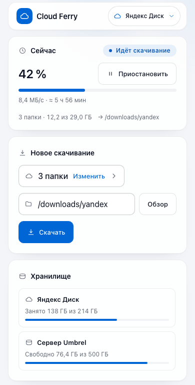

# Cloud Ferry

Скачивает файлы с Яндекс Диска на домашний сервер Umbrel: весь Диск или выбранные папки.

## Установка

1. Umbrel → App Store → ⋮ → Community App Stores → Add → `https://github.com/Chikurov/cloud-ferry`
2. Установите Cloud Ferry и откройте приложение.
3. Подключите Яндекс Диск и запустите скачивание.

## Возможности

- Весь Диск или выбранные папки — до 20 за раз.
- Прогресс, скорость и остаток времени; пауза и продолжение.
- Занятое место в облаке и свободное на сервере.
- Создание папки на сервере прямо в окне выбора.
- Подключение паролем приложения, OAuth-приложением или готовым токеном.
- Вход по коду через своё OAuth-приложение: пользователю не нужны ID и секрет.
- Ничего не удаляет: только добавляет и обновляет файлы.

## Вход через Яндекс

Диск подключается паролем приложения (нужна подписка Яндекс 360) или входом
через Яндекс ID по коду подтверждения. Второй способ удобнее, когда у сервера
есть **своё** OAuth-приложение: пользователь вводит только код, а ID и секрет
приложения остаются на сервере.

1. Создайте приложение на [oauth.yandex.ru](https://oauth.yandex.ru/client/new):
   платформа «Веб-сервисы», доступ `cloud_api:disk.read` (чтение Диска).
2. Redirect URI не нужен: вход идёт через device flow, код подтверждения
   вводится на странице Яндекса.
3. Задайте окружение сервиса `api`:

   | Переменная | Значение |
   | --- | --- |
   | `CF_YANDEX_CLIENT_ID` | ID приложения |
   | `CF_YANDEX_CLIENT_SECRET` | секрет приложения |

   Алиасы — `YANDEX_CLIENT_ID` и `YANDEX_CLIENT_SECRET`. В Umbrel значения
   задаются в настройках приложения, в standalone-сборке — в `.env`.
4. Перезапустите приложение. `GET /api/oauth/yandex/status` начнёт возвращать
   `{"available":true}`, и вход больше не спрашивает ID и секрет. Если обе
   переменные не заданы, всё работает как раньше: ID и секрет вводит
   пользователь.

Секрет не попадает в ответы API, логи и `state.json`, но остаётся в
инфраструктуре: в окружении `api` и в конфиге rclone на сервере — без него
rclone не обновит токен. Если приложение заблокируют в Яндексе, вход по коду
сломается сразу у всех пользователей; в логах виден только ID приложения, не
секрет.

## Выбор папок

Отметьте нужные папки в дереве Диска — вложенность сохраняется, выбрать можно до 20 папок.

## Папка на сервере

Куда скачивать, выбирается на сервере. Если нужной папки ещё нет, создайте её прямо в окне выбора: за раз создаётся одна папка внутри уже открытой, без вложенных уровней. За пределы папок, разрешённых при установке, приложение не выходит.

## На телефоне

Интерфейс подстраивается под ширину экрана: те же карточки, кнопки и прогресс.

## Ограничения

- Один аккаунт Яндекс Диска.
- Недокачанный после перезапуска файл скачивается заново.
- Альбомы «Фото» и история версий не скачиваются.

## Лицензия

MIT. Сборка, публикация и откат — в [INSTALL.md](INSTALL.md).
