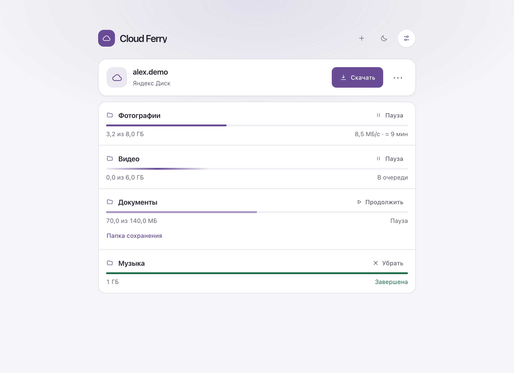
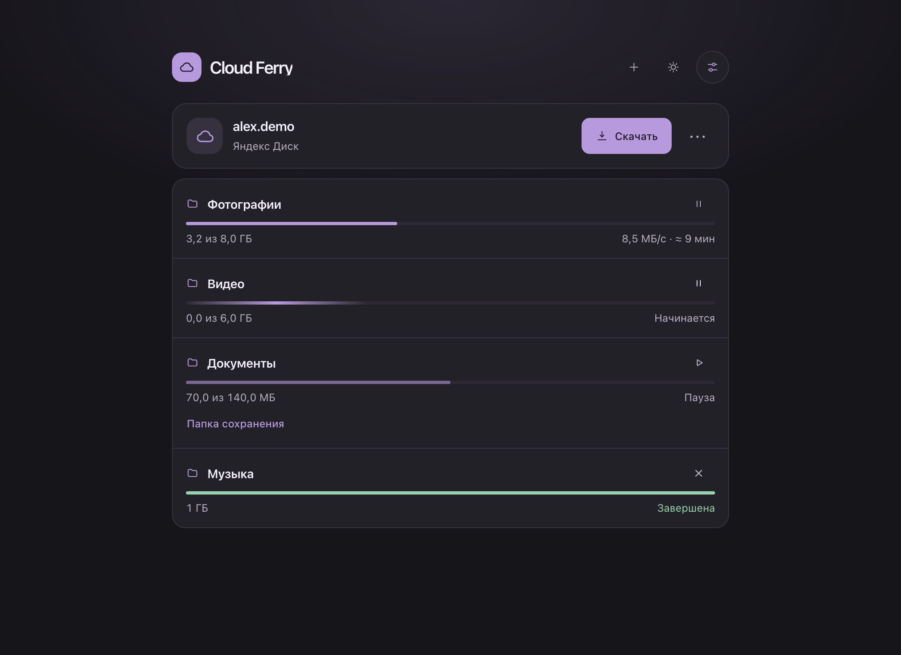
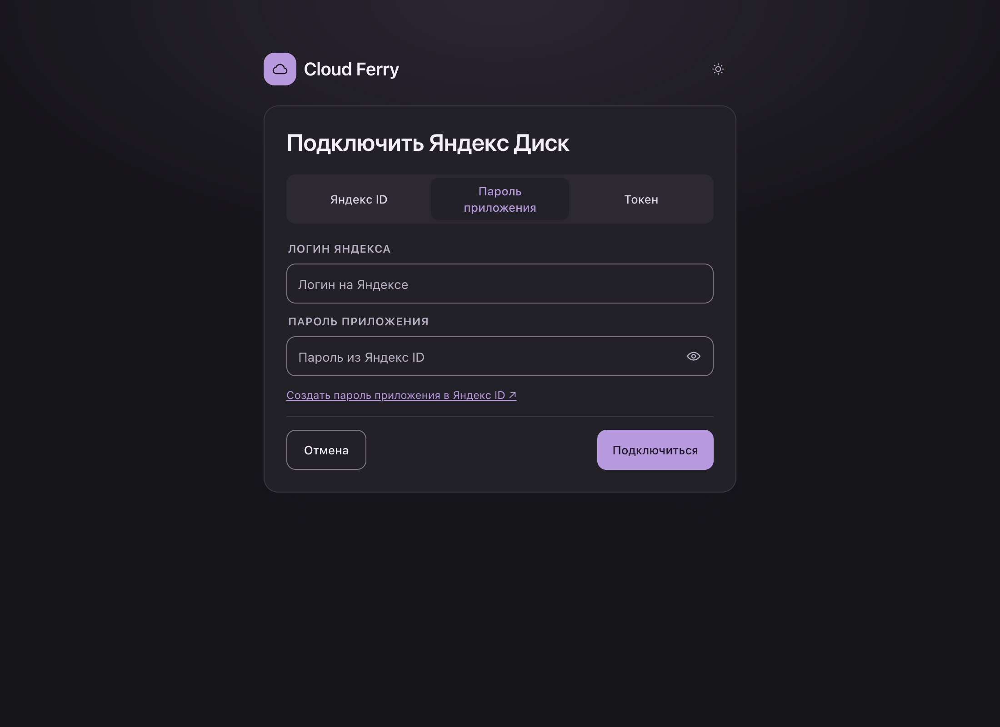
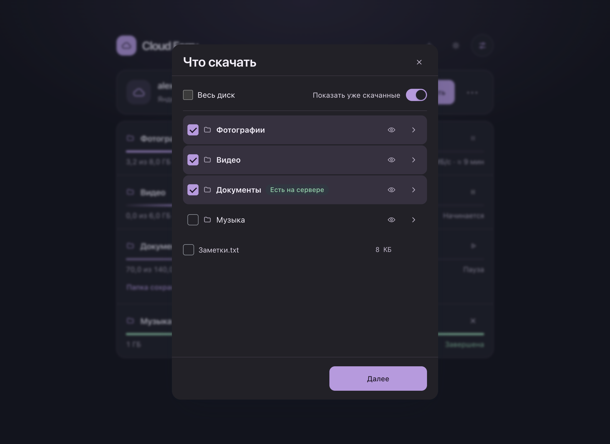
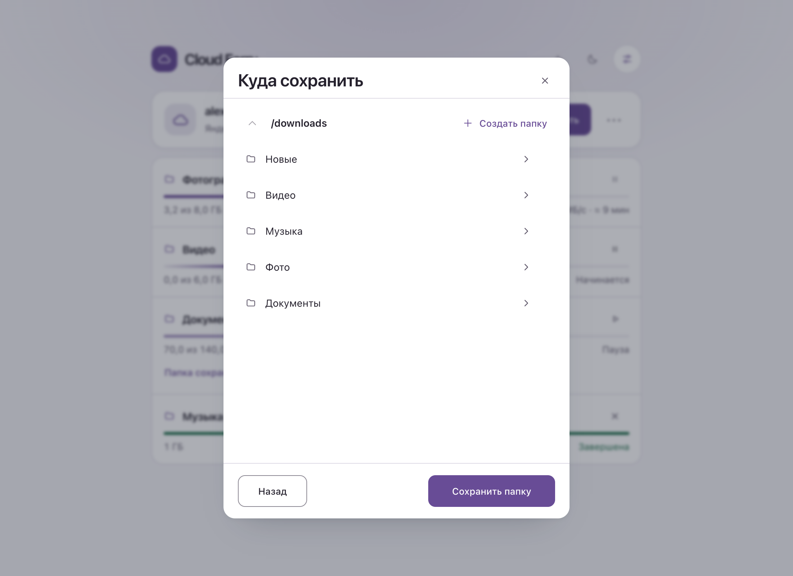
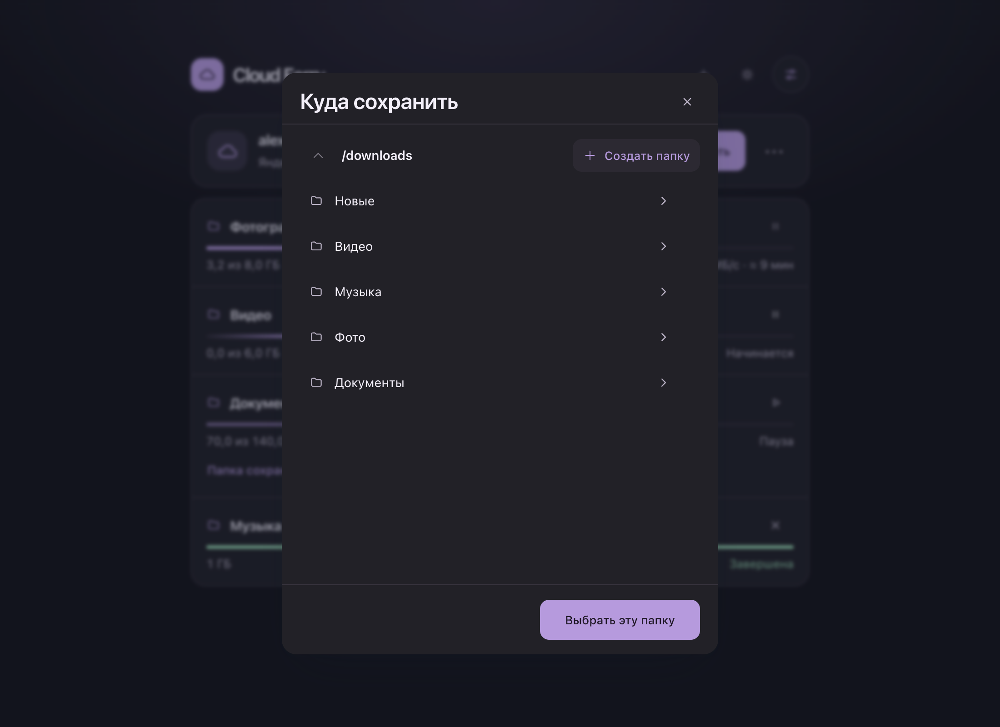

# Cloud Ferry

Cloud Ferry копирует папки и файлы с Яндекс Диска на Umbrel. Можно подключить несколько дисков и вести параллельные загрузки в разные папки.

## Посмотреть демо

Откройте **preview.html** в браузере. Демо работает локально на учебных данных. Переключатель профиля, тема, выбор содержимого, смена папки и действия с загрузками доступны сразу. Нажмите **+ → Яндекс ID → Получить код**, затем **Ввести код в Яндексе**. В демо откроется локальное окно подтверждения. Для первого запуска с пустым экраном добавьте к адресу файла `?empty`. Параметр `?manual` показывает вариант сервера без настроенного OAuth.

Скриншоты ниже сняты из этого демо (`python3 scripts/screenshots.py`), светлая и тёмная тема рядом.

## Запустить сервер из этих исходников

Для проверки этой редакции используйте локальную сборку в **deploy/standalone**. Подготовка каталогов и файла окружения описана в [инструкции](deploy/standalone/README.md). Из каталога `deploy/standalone` выполните `docker compose up -d --build`. Пакет App Store в архиве ссылается на уже опубликованный образ 0.5.0.

## Требования

- Umbrel с umbrelOS 2.0+.
- Аккаунт Яндекс Диска.

## Ограничения

- Альбомы «Фото» и история версий не скачиваются.
- Недокачанный файл после паузы или перезапуска скачивается заново; уже
  скачанные файлы повторно не скачиваются.
- Большие папки показываются частично: в одной папке видно до 500 подпапок
  и до 200 файлов.
- Сервер ограничивает расчёт объёма десятью минутами.

## Документация

- [Руководство пользователя](docs/USER-GUIDE.md)
- [Сборка и установка](INSTALL.md)
- [Устройство и безопасность](docs/ARCHITECTURE.md)

## О проекте

Приложение написано с помощью DeepSeek: код, интерфейс и документация
создавались в паре с ИИ-агентом и проверялись тестами.

Если нашли баг или знаете, как сделать лучше, — откройте
[pull request](https://github.com/Chikurov/cloud-ferry/pulls) или
[issue](https://github.com/Chikurov/cloud-ferry/issues) с описанием и
предложенным решением.

## Лицензия

MIT — см. [LICENSE](LICENSE).
