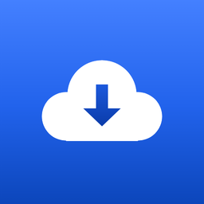
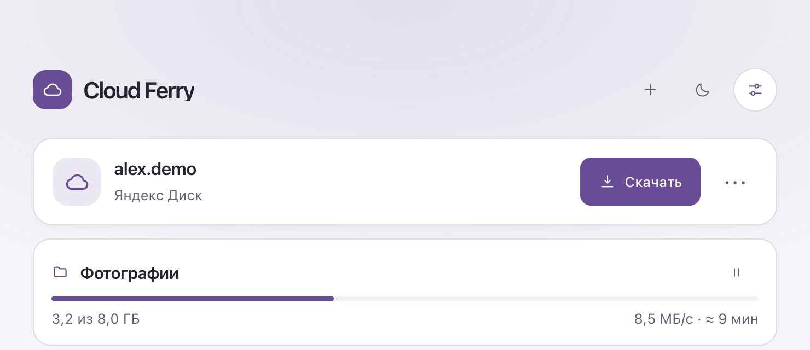
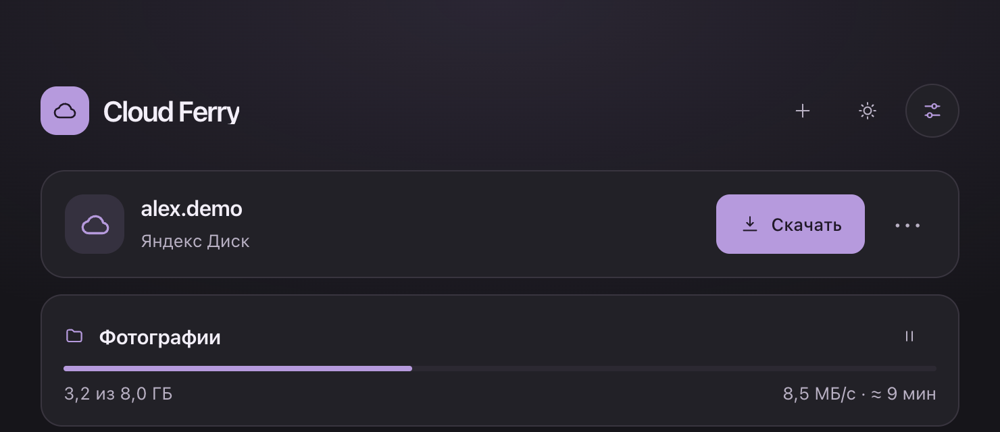
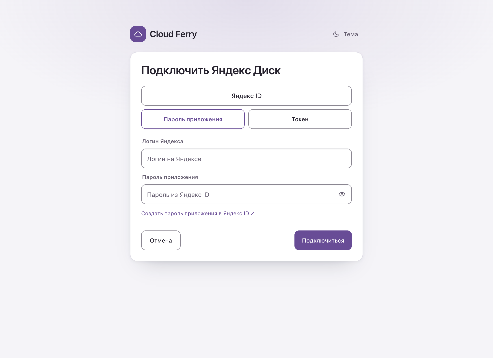
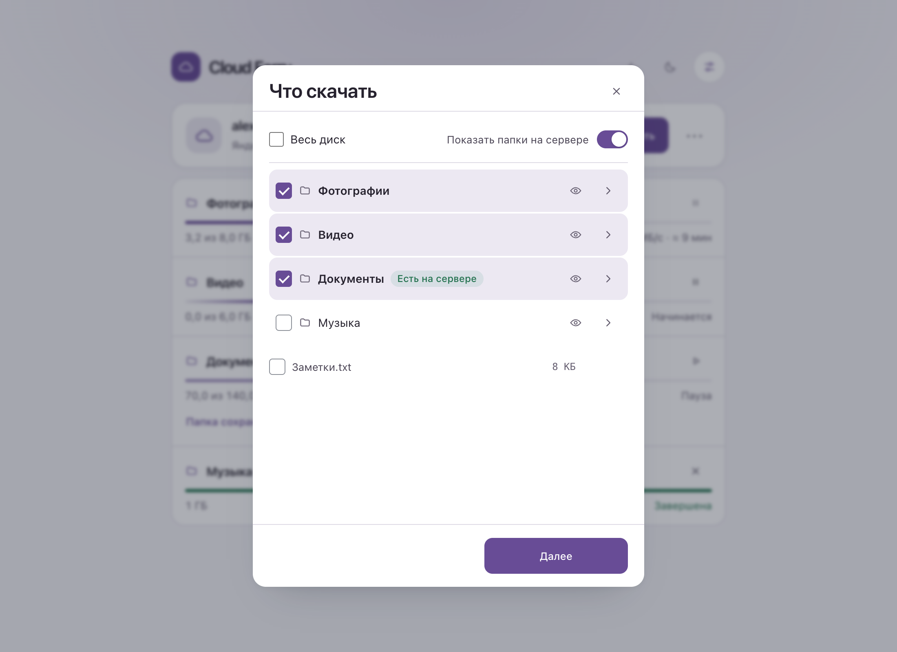

<p align="center"></p>
<h1 align="center">Cloud Ferry</h1>
<p align="center">Файлы с Яндекс Диска — на вашем Umbrel</p>
<p align="center"><a href="#запуск">Установка</a> · <a href="docs/USER-GUIDE.md">Руководство</a> · <a href="docs/DEVELOPMENT.md">Разработка</a></p>

Скачивайте папки, отдельные файлы или весь диск на домашний сервер. Управляйте загрузками нескольких аккаунтов в одном интерфейсе.



<details>
<summary>Тёмная тема</summary>



</details>

*Интерфейс на демонстрационных данных.*

## Возможности

- Выбор папок и файлов, весь диск с исключениями.
- Несколько аккаунтов и параллельные загрузки.
- Пауза, продолжение и смена папки назначения.
- Светлая и тёмная темы.

## Запуск

Для запуска текущих исходников на Umbrel подготовьте каталоги и `.env` по [инструкции Docker Compose](deploy/standalone/README.md), затем из корня проекта выполните:

```bash
cd deploy/standalone
docker compose up -d --build
```

Откройте `http://umbrel.local:8741` и введите логин и пароль из `.env`.

[Установка через App Store и публикация](INSTALL.md) описаны отдельно. Установка через App Store использует закреплённый образ. Для проверки изменений из ветки PR собирайте приложение из исходников.

Чтобы посмотреть интерфейс без установки, откройте `preview.html` в браузере. Демо работает на учебных данных и не скачивает файлы.

## Как скачать

1. **Подключите диск** — через Яндекс ID, пароль приложения или готовый токен.
2. Нажмите **Скачать** и выберите папки, файлы или весь диск.
3. Укажите папку на Umbrel и нажмите **Скачать**.

Вход через Яндекс ID по коду требует настройки OAuth на сервере. [Способы подключения и управление загрузками →](docs/USER-GUIDE.md)

<details>
<summary>Другие экраны</summary>

**Управление загрузками**


**Подключение диска**



**Выбор содержимого**



**Папка назначения**


</details>

## Что учитывать

- Для параллельных загрузок нужны отдельные папки назначения, не вложенные друг в друга.
- При смене назначения уже скачанные файлы остаются в прежней папке.
- После паузы незавершённый файл может скачиваться с начала.

[Существующие файлы и ограничения выбора →](docs/USER-GUIDE.md#5-как-скачать-файлы)

## Документация и обратная связь

[Архитектура](docs/ARCHITECTURE.md) · [Сборка, кэш и упаковка](docs/DEVELOPMENT.md) · [Сообщить о проблеме](https://github.com/Chikurov/cloud-ferry/issues) · [Предложить изменение](https://github.com/Chikurov/cloud-ferry/pulls)

Проект создавался с помощью DeepSeek. Лицензия — [MIT](LICENSE).
