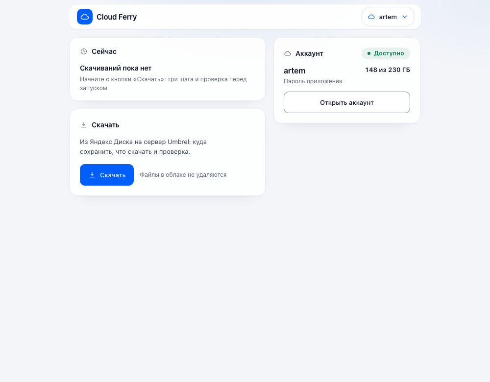

# Cloud Ferry

Скачивает файлы с Яндекс Диска на домашний сервер Umbrel: весь Диск или
выбранные папки, с прогрессом и паузой.

## Установка

1. Umbrel → App Store → ⋮ → Community App Stores → Add →
   `https://github.com/Chikurov/cloud-ferry`.
2. Установите Cloud Ferry и откройте приложение.
3. Подключите Яндекс Диск и запустите первое скачивание.

Подробно — [руководство пользователя](docs/USER-GUIDE.md), сборка и публикация —
[INSTALL.md](INSTALL.md).

## Возможности

- Три шага: куда сохранить → что скачать → проверка с объёмом и свободным местом.
- Весь Диск или выбранные папки и файлы: до 20 папок и 100 отдельных файлов.
- Пометка «Папка есть на сервере» и фильтр «Показать уже скачанные» (включён по умолчанию).
- Прогресс, скорость и остаток времени; пауза и продолжение.
- Панель аккаунта: логин, доступ, занятое место на Диске и свободное на сервере.
- Только добавление: файлы в облаке и на сервере не удаляются.
- Мобильный экран: те же шаги и статусы на узком экране.

## Ограничения

- Один аккаунт Яндекс Диска.
- Пароль приложения требует подписки Яндекс 360. Неверный пароль не просит ждать.
- Альбомы «Фото» и история версий не скачиваются.
- Недокачанный файл после паузы или перезапуска скачивается заново; уже
  скачанные файлы — нет.
- При нехватке места скачивание останавливается, не заполняя диск полностью.

## Документация

- [Руководство пользователя](docs/USER-GUIDE.md)
- [Устройство и безопасность](docs/ARCHITECTURE.md)
- [Сценарии интерфейса](docs/flows.md) и [архитектура флоу](docs/flows-architecture.md)
- [Сборка и установка](INSTALL.md)

## Лицензия

MIT.
