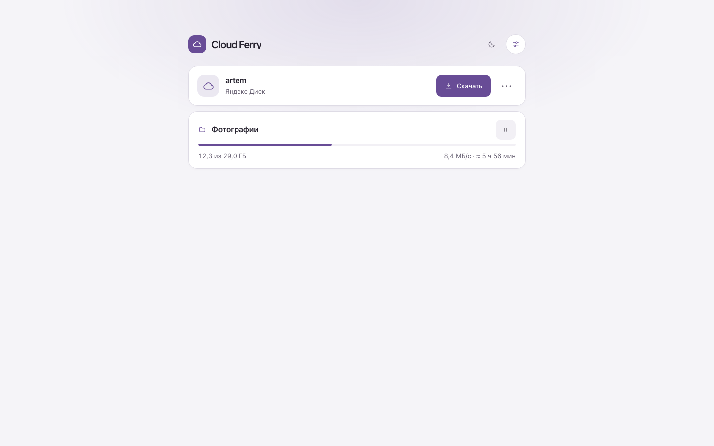
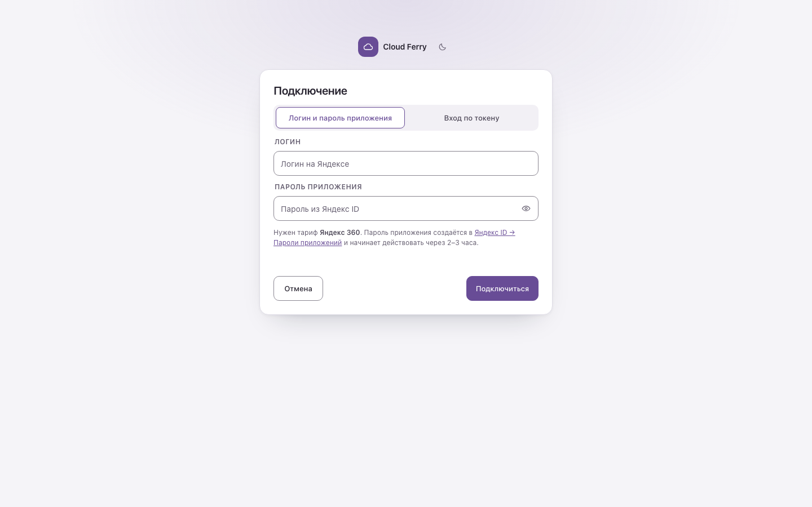
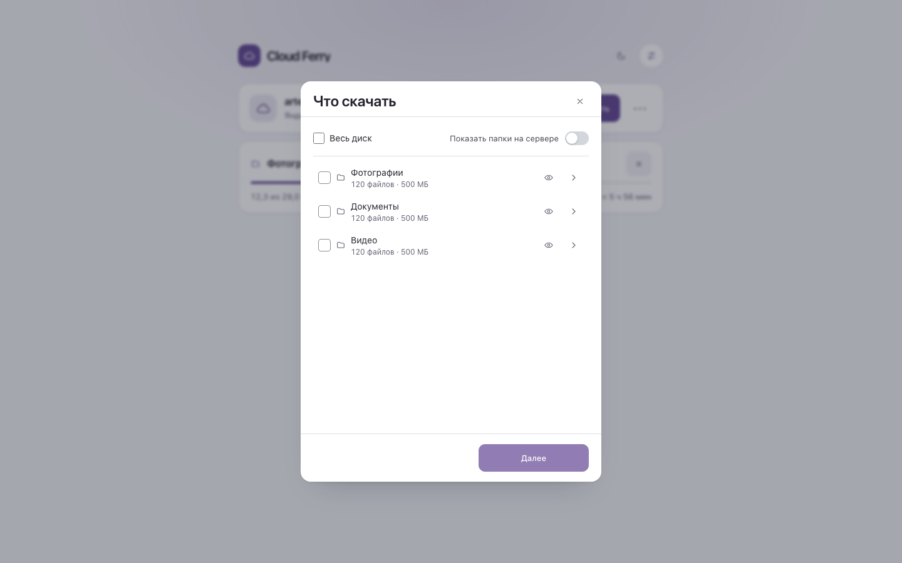
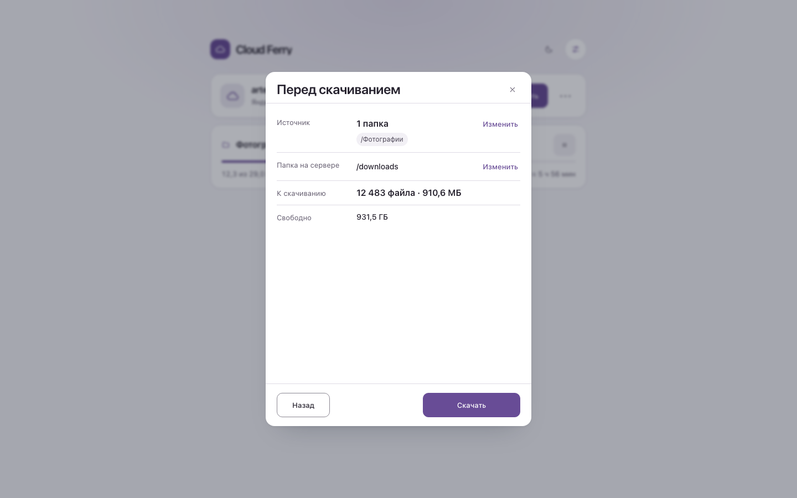
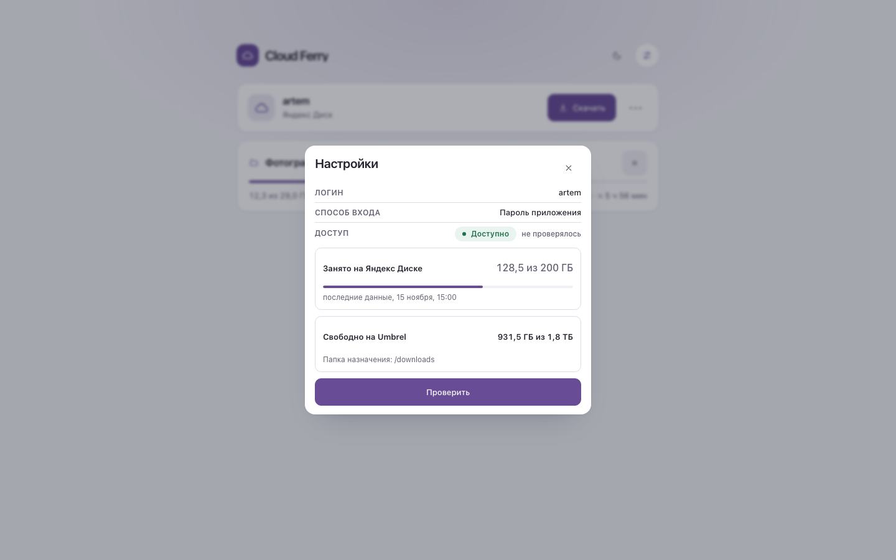

# Cloud Ferry: руководство пользователя

Cloud Ferry скачивает файлы с Яндекс Диска в папку на вашем Umbrel. Приложение
только читает облако и добавляет файлы на сервер: в облаке ничего не удаляется,
на сервере существующие файлы тоже не удаляются.



_Главный экран: строка диска с кнопкой «Скачать», карточка скачивания с
прогрессом; справа в шапке — переключатель темы и кнопка «Настройки»._

## 1. Установка

1. Umbrel → **App Store** → ⋮ → **Community App Stores** → **Add** →
   `https://github.com/Chikurov/cloud-ferry`.
2. Установите **Cloud Ferry** и откройте приложение на `http://umbrel.local:8741`.
3. Нажмите **«Подключить диск»**, укажите пароль приложения или токен.

Приложение открывается с логином Umbrel: отдельной регистрации в Cloud Ferry
нет. Сборка и обновление — в [INSTALL.md](../INSTALL.md).

## 2. Первый запуск

Пока диск не подключён, на главном экране стоит кнопка **«Подключить диск»** с
плюсом. Она открывает экран **«Подключение»** (раздел 3). После успешного
подключения приложение сразу показывает главный экран.

**Тема.** Кнопка с луной или солнцем в шапке переключает светлую и тёмную тему.
Выбор сохраняется в этом браузере; пока вы его не сделали, приложение берёт
тему из настроек системы. Кнопка есть и на главном экране, и на экране «Подключение».

## 3. Подключение Яндекс Диска



_Экран «Подключение»: способы входа видны сразу._

Экран **«Подключение»** сразу показывает доступные способы входа:

- **«Яндекс ID»** — если сервер настроен со своим приложением
  Яндекса; этот способ показывается первым;
- **«Пароль приложения»** — нужна подписка Яндекс 360;
- **«Токен»** — подписка не нужна.

Способы переключаются кнопками-вкладками, введённое при переключении не теряется.
На вкладках с паролем и токеном внизу — **«Отмена»** и **«Подключиться»**; на
вкладке «Яндекс ID» внизу только «Отмена», а основное действие
«Получить код» находится в самой панели. Пока приложение проверяет данные, на
кнопке видно «Подключиться», а в строке состояния — «Проверяем доступ к
Яндекс Диску…».

Можно подключить несколько аккаунтов Яндекс Диска. Новый диск добавляется к
уже подключённым; предыдущие не удаляются. На главном экране активный диск
выбирается в строке диска. Скачивания идут в контексте выбранного аккаунта.

### 3.1. Пароль приложения

Подходит, если есть подписка **Яндекс 360**: без неё доступ по WebDAV закрыт и
появится сообщение «WebDAV недоступен — нужен Яндекс 360».

1. Создайте пароль приложения в
   [Яндекс ID → Пароли приложений](https://id.yandex.ru/security/app-passwords),
   тип — файлы (WebDAV).
2. В приложении выберите **«Пароль приложения»**, заполните поля
   **«Логин Яндекса»** (подсказка «Логин на Яндексе») и **«Пароль приложения»**
   (подсказка «Пароль из Яндекс ID»). Кнопка с глазом показывает и скрывает
   пароль.
3. Нажмите **«Подключиться»**.

Пароль приложения начинает действовать через 2–3 часа: если Яндекс не принял
только что созданный пароль, подождите и повторите вход. Об этом напоминает
подсказка под полями: нужен тариф «Яндекс 360», а пароль приложения создаётся в
Яндекс ID → Пароли приложений.

### 3.2. Яндекс ID

Способ доступен, только если сервер настроен со своим приложением Яндекса.
Подписка 360 и пароль приложения не нужны: нажмите **«Получить код»**, откройте
`https://oauth.yandex.ru/device`, введите код вида `ABCD-1234` и подтвердите
вход. Код действует 10 минут, приложение проверяет подтверждение само и пишет
«Ждём подтверждение…». Если код истёк — **«Получить новый код»**; начатый вход
можно отменить кнопкой **«Отменить»**.

### 3.3. Токен

Способ для тех, у кого нет Яндекс 360.

1. Создайте приложение на [oauth.yandex.ru](https://oauth.yandex.ru/client/new)
   с доступом `cloud_api:disk.read`.
2. Откройте
   `https://oauth.yandex.ru/authorize?response_type=code&client_id=ВАШ_ID`,
   разрешите доступ и заберите код из адресной строки.
3. Нажмите **«Как получить токен?»**, скопируйте команду кнопкой
   **«Скопировать»** (появится «Команда скопирована»), обменяйте код на токен и
   вставьте в поле **«Токен»** весь JSON из ответа — подсказка поля: «Вставьте
   токен или JSON из ответа».

В JSON нужны `access_token` и `refresh_token`:

```json
{"access_token":"y0_Ag…","refresh_token":"1//0g…","token_type":"bearer"}
```

Одного `access_token` мало: обычный access-токен истекает примерно через час, и
без `refresh_token` подключение перестанет работать. Строку с токеном
приложение тоже принимает, если в ней нет пробелов, но обновлять такой доступ
оно не сможет.

### 3.4. Если не подключается

| Сообщение | Что делать |
|---|---|
| «Неверный логин или пароль приложения. Проверьте данные из Яндекс ID.» | Проверить логин и пароль; новый пароль приложения начинает действовать через 2–3 часа. |
| «WebDAV недоступен — нужен Яндекс 360» | Оформить 360, войти через Яндекс или по токену. |
| «Токен не подошёл или истёк. Проверьте, что скопировали его целиком.» | Получить новый JSON с `refresh_token`. |
| «Не удалось разобрать JSON. Вставьте токен строкой или целиком JSON.» | Скопировать весь ответ, не обрезать его. |
| «В JSON нет поля access_token.» | Вставить JSON именно с `access_token`. |
| «Токен выглядит неполным — скопируйте его целиком, без пробелов.» | Скопировать токен без переносов и пробелов. |
| «Сервер не ответил — попробуйте ещё раз.» | Проверить, что приложение запущено, и повторить. |
| «На сервере не настроены ключи приложения. Выберите пароль приложения или токен.» | Выбрать пароль приложения или токен. |
| «Слишком много попыток, подождите минуту.» | Подождать минуту и получить код снова. |

## 4. Главный экран

Сверху — **шапка**: название Cloud Ferry, кнопка **«+»** (подключить ещё один
диск), переключатель темы и кнопка **«Настройки»** (иконка с ползунками). Под
шапкой — **строка диска**: значок облака, логин (или список дисков, если их
несколько), подпись «Яндекс Диск», кнопка **«Скачать»** и меню **«•••»**
(«Действия с диском») с пунктом **«Выйти из аккаунта»**. При потере связи
появляется значок состояния и полоса «Нет связи с сервером».

Под строкой диска появляются **карточки скачиваний**: название источника,
прогресс, объём вида 12,3 из 29,0 ГБ, скорость и остаток времени, кнопка
действия (пауза, продолжение или крестик). Пока задач нет, под строкой пусто —
это нормально.

Если доступ к облаку истёк, в блоке «Сейчас» появляется отметка **«Нужен
вход»**, текст «Яндекс Диск просит войти заново» и кнопка **«Войти заново»**.

## 5. Как скачать файлы

Нажмите **«Скачать»** — откроется окно скачивания. Первым показывается шаг
**«Что скачать»**; проверка и запуск — на шаге **«Сохранить на Umbrel»**; папку
на сервере можно изменить там же кнопкой «Изменить».

### 5.1. «Что скачать»



_Шаг «Что скачать»: «Весь диск», переключатель папок на сервере, папки облака._

- **Папки и файлы облака.** Галочка выбирает папку целиком; стрелка раскрывает
  вложенные папки, кнопка с глазом открывает файлы внутри папки. Файлы из корня
  Диска тоже можно отметить отдельно. У папки видны число файлов и размер,
  если сервер успел их посчитать.
- **«Весь диск».** Включает копирование всего Диска. Отдельные папки можно
  снять с выбора — они уйдут в исключения и не скачаются. Лимиты 20 папок и
  100 файлов к режиму «Весь диск» не применяются. Чтобы вернуться к ручному
  выбору, выключите переключатель.
- **«Есть на сервере».** Пометка у папки, которая уже есть в папке назначения.
  Она означает, что папка на месте, а не что скачаны все файлы. Пустая такая
  папка подписана «Пустая папка на сервере». Пометка не запрещает выбор.
- **«Показать папки на сервере».** Переключатель управляет видимостью папок,
  которые уже есть на сервере; **включён по умолчанию**. Он меняет только
  видимость: выбор и исключения не сбрасываются. Если сервер не умеет
  проверять скачанное, вместо переключателя написано «Проверка недоступна на
  этом сервере». Если проверка не удалась — строка «Не удалось проверить, что
  уже скачано.» и кнопка **«Повторить»**.

Файлы внутри папки открываются кнопкой с глазом: там есть **«Выбрать все
файлы»**, отдельные галочки и кнопка **«Выбрать папку»** (если файлов больше,
чем помещается в список). Если папка выбрана целиком, все её файлы скачаются
без отдельного выбора.

**Лимиты.** За одно скачивание можно выбрать не больше **20 папок** и
**100 отдельных файлов**. При превышении появляется «Можно выбрать не больше
20 папок» или «Можно выбрать не больше 100 отдельных файлов», а выбор не
меняется. Папки внутри выбранной папки отдельно не считаются и мест не
занимают.

Кнопка **«Далее»** внизу недоступна, пока ничего не выбрано. Она открывает шаг
«Сохранить на Umbrel».

### 5.2. «Сохранить на Umbrel»



_Шаг «Сохранить на Umbrel»: строки «Источник», «Папка на сервере», «К
скачиванию», «Свободно» и кнопки «Назад» / «Скачать»._

На шаге четыре строки:

- **«Источник»** — что выбрано (папки и файлы; длинный список сворачивается и
  раскрывается). Кнопка **«Изменить»** возвращает на «Что скачать».
- **«Папка на сервере»** — куда сохранятся файлы. Кнопка **«Изменить»**
  открывает шаг «Куда сохранить».
- **«К скачиванию»** — сколько файлов и какой объём (например, 12 483 файла · 910,6 МБ).
  Пока объём считается — «Считаем объём…»; если это длится больше 20 секунд,
  рядом появляется «Оценка ещё идёт». Если места не хватает, видно «Не хватает
  …» и кнопка **«Скачать»** недоступна. Если объём посчитать не удалось —
  «Не удалось оценить объём» или «Оценка не завершилась за 10 минут» и кнопка
  **«Повторить»**. Для пустого выбора написано «Файлов не найдено — возможно,
  выбранные папки пусты.»
- **«Свободно»** — свободное место на сервере (прочерк, если сервер его ещё
  не сообщил).

Внизу — **«Назад»** (возврат к выбору) и **«Скачать»**. Кнопка «Скачать»
недоступна, если не хватает места или пока идёт запуск.

### 5.3. «Куда сохранить»

Шаг открывается кнопкой **«Изменить»** у строки «Папка на сервере». Здесь
видны текущий путь, кнопка **«На уровень выше»**, вложенные папки и кнопка
**«Создать папку»**: введите **«Название папки»** и нажмите **«Создать»**
(или **«Отмена»**). Новая папка создаётся внутри открытой, путь не меняется
сам по себе. Кнопка **«Сохранить папку»** подтверждает выбор, **«Назад»**
возвращает к проверке, ничего не меняя.

По умолчанию файлы сохраняются в `/downloads` — папку Downloads в Umbrel, её
видно в Files. Папку можно сменить на любую доступную внутри неё.

### 5.4. Запуск

Нажмите **«Скачать»**. Внизу появится «Запускаем…», окно закроется, появится
сообщение «Скачивание началось», а карточка задачи — на главном экране. Если
ответ сервера потерялся, приложение повторяет запуск безопасно: вторая задача
не создаётся, а сообщение может сказать «Скачивание уже запущено».

## 6. Что значат состояния задачи

В карточке задачи видны состояние, действие и прогресс.

| Состояние | Что видно в карточке | Действие |
|---|---|---|
| В очереди | «В очереди»; у возобновлённой — «Продолжаем…» | «Пауза» / «Приостановить» |
| Идёт скачивание | прогресс, объём вида 12,3 из 29,0 ГБ, скорость и остаток вида ≈ 5 ч 56 мин; у новой задачи без байт — «Начинается», пока движок сверяет уже скачанное — «Проверяем, что уже скачано…» и бегущий блик по полосе | «Пауза» / «Приостановить» |
| Пауза | «Пауза» | «Продолжить» |
| Готово | «Завершена», 100 %, число файлов, объём и время | «Убрать из списка» |
| Ошибка | «Не удалось», причина, «Не скачались: N», список файлов и ссылка «Повторить» | «Повторить», «Скопировать список» |
| Нужен вход | блок «Сейчас» с отметкой «Нужен вход» и текстом «Яндекс Диск просит войти заново» | «Войти заново» |

Ошибка в интерфейсе называется «Не удалось», а не «Ошибка». Если приложение
встретило незнакомое состояние, карточка пишет «Неизвестное состояние
скачивания» и предлагает **«Обновить»** — обычно это значит, что сервер
обновился, а страница ещё нет.

## 7. Пауза, продолжение и перезапуск

- **«Приостановить»** доступна для «Ожидает запуска» и идущего скачивания.
  После остановки карточка переходит в «Пауза», появляется сообщение
  «Скачивание приостановлено». Если движок не подтвердил остановку сразу,
  сообщение называется «Скачивание приостановлено не сразу»: если прогресс
  продолжится, перезапустите Cloud Ferry.
- **«Продолжить»** запускает задачу снова. Уже скачанные файлы не скачиваются
  повторно, недокачанный файл начинается заново — так работает движок
  скачивания.
- Закрытие вкладки браузера скачивание не останавливает: задача живёт на
  сервере.
- **«Убрать из списка»** убирает завершённую карточку с главного экрана; сама
  задача и файлы остаются.

После перезапуска сервера состояние задач сохраняется: незавершённая задача
показывается как «Пауза» с кнопкой «Продолжить», а задача, успевшая завершиться
без приложения, получает настоящий результат — «Завершена» или «Не удалось».
Если движок всё ещё работает, приложение подхватывает задачу и продолжает
показывать прогресс. После перезагрузки Umbrel откройте приложение и нажмите
«Продолжить», если задача на паузе.

## 8. Ошибки и что делать

**Не хватает места.** На шаге «Сохранить на Umbrel» — «Не хватает …», кнопка
«Скачать» недоступна. Во время скачивания приложение останавливается, не
заполняя диск: «Скачивание остановилось из-за лимита места» или «На сервере
закончилось место». Освободите место и нажмите «Продолжить». Если до запуска
места не хватило на проверке, выберите другую папку кнопкой «Изменить» и
запустите скачивание снова.

**Часть файлов не скачалась.** Состояние «Не удалось», причина и «Не
скачались: N», ниже список. **«Повторить»** запускает задачу заново: целые
файлы пропускаются, оборванный файл начинается сначала. **«Скопировать
список»** копирует пути в буфер и показывает «Список скопирован».

**Нет связи.** Сверху появляется полоса **«Нет связи с сервером»** с кнопкой
**«Повторить»** и пометкой «Показаны последние данные». Скачивание на сервере
может продолжаться. Проверьте, что приложение запущено.

**Нужен вход.** В настройках и в блоке «Сейчас» — «Нужен вход». Нажмите
**«Войти заново»** и повторите вход. Если в этот момент идёт скачивание,
сначала приостановите его: приложение не заменит подключение, пока задача
активна. Уже скачанные файлы останутся на сервере.

**Другие причины** приложение объясняет словами:

| Сообщение | Что делать |
|---|---|
| «Облако ограничило скорость» | Подождать несколько минут и нажать «Продолжить»; если повторяется — уменьшить число одновременных файлов в настройках приложения Umbrel. |
| «Папка не найдена» | Проверить папку в облаке: её могли переименовать или удалить. |
| «Нет доступа к папке» | Проверить доступ подключения к папке или выбрать другую. |
| «Нет связи с облаком» | Проверить интернет на сервере и нажать «Продолжить». |
| «Нужно снова войти в облако» | Войти заново: доступ больше не действует. |
| «Яндекс отключил этот способ входа» | Подключить диск заново по паролю приложения или через приложение Яндекса. |
| «Нужно подключить облако заново» | Срок доступа истёк: подключить облако снова. |
| «Этот аккаунт Яндекса не подойдёт» | Для Диска нужен аккаунт с Яндекс Почтой. |
| «Слишком длинное имя файла» | Переименовать файл в облаке и нажать «Продолжить». |
| «В облаке нет свободного места» | Освободить место в облаке и нажать «Продолжить». |

Если не удалось обновить данные, появится сообщение «Не удалось обновить
данные» с кнопкой «Обновить» или «Повторить» — это не отменяет уже выполненные
действия.

## 9. Настройки и аккаунт



_Панель «Настройки»: доступ, занятое место на Диске, свободное место на
Umbrel и кнопка «Проверить»._

Кнопка **«Настройки»** в шапке открывает панель:

- **«Логин»** — логин подключённого Яндекс Диска;
- **«Способ входа»** — «Яндекс ID», «Пароль приложения» или «Токен»;
- **«Доступ»** — «Доступно», «Нужен вход» или «Не проверялось», рядом время
  проверки: «проверено сегодня, 14:32» или «не проверялось»;
- **«Занято на Яндекс Диске»** — например, 128,5 из 200 ГБ; пометка «последние
  данные» означает, что цифры могли устареть. Если место ещё не проверялось,
  написано «Нажмите «Проверить», чтобы узнать занятое место.»;
- **«Свободно на Umbrel»** — свободное место на сервере и подпись «Папка
  назначения» с путём (по умолчанию `/downloads`);
- **«Проверить»** — проверяет доступ и обновляет занятое место; результат
  остаётся в панели: «Доступ есть. …» или «Нужно войти заново: Яндекс Диск не
  принял сохранённый доступ.»

**Выход.** Меню **«•••»** рядом с кнопкой «Скачать» → **«Выйти из аккаунта»**.
Появится подтверждение «Выйти из аккаунта?» и предупреждение «Активное
скачивание остановится.»; кнопки — «Остаться» и «Выйти». Выход останавливает
активное скачивание и удаляет подключение; скачанные файлы остаются на
сервере. После выхода на главном экране снова кнопка «Подключить диск», а
подключиться можно в любой момент.

## 10. Телефон и тема

На телефоне шапка и строка диска остаются сверху, карточки скачиваний идут
друг под другом на всю ширину, кнопки крупные. Окно скачивания занимает весь
экран: шапка с крестиком и кнопки внизу на месте, прокручивается только
содержимое. Подписи и шаги те же, что на компьютере.

Светлая и тёмная темы описаны в разделе 2: переключатель в шапке, выбор
запоминается в браузере.

## 11. Ограничения и частые вопросы

**Ограничения.**

- Можно подключить несколько аккаунтов; активный диск выбирается на главном
  экране.
- Альбомы «Фото» и история версий не скачиваются.
- За одно скачивание — до 20 папок и 100 отдельных файлов.
- Большие папки показываются частично: в папке облака видно до 200 файлов, в
  дереве — до 500 подпапок. Чтобы скачать папку целиком, выбирайте саму папку.
- Недокачанный файл после паузы или перезапуска скачивается заново; уже
  скачанные файлы повторно не скачиваются.
- Оценку объёма нельзя отменить на сервере: после ухода с шага она может идти
  до 10 минут.

**Нужен ли Яндекс 360?** Только для пароля приложения (WebDAV). Вход через
Яндекс и токен подписки не требуют.

**Удаляются ли файлы?** Нет. В облаке приложение только читает. На сервере оно
добавляет новые файлы и обновляет изменившиеся, но ничего не удаляет.

**Можно ли скачать ещё раз?** Да. Совпадающие файлы не скачиваются повторно,
изменившиеся обновляются.

**Куда попадают файлы?** В папку со строки «Папка на сервере» (шаг «Куда
сохранить»). По умолчанию `/downloads` — папка Downloads в Umbrel, она видна в
Files.

**Почему нужной папки не видно?** Возможно, выключен переключатель «Показать
папки на сервере» и папка уже есть на сервере (тогда она скрыта), либо папка
находится глубже в дереве облака. Проверьте Яндекс Диск.

**Можно ли отменить скачивание совсем?** Приостановить — да. Удалить задачу с
сервера нельзя; завершённую карточку можно убрать с главного экрана.

**Что значит «Есть на сервере»?** Папка с таким именем уже есть в папке
назначения. Это не гарантия, что внутри все файлы скачаны.

## 12. Ссылки

- [Устройство и безопасность](ARCHITECTURE.md)
- [Установка и обновление](../INSTALL.md)
