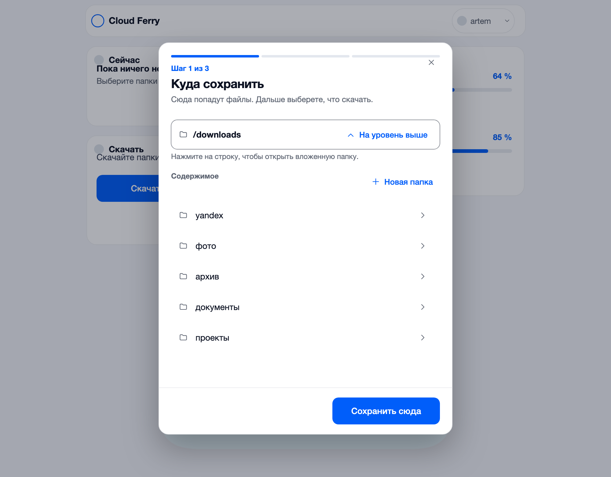
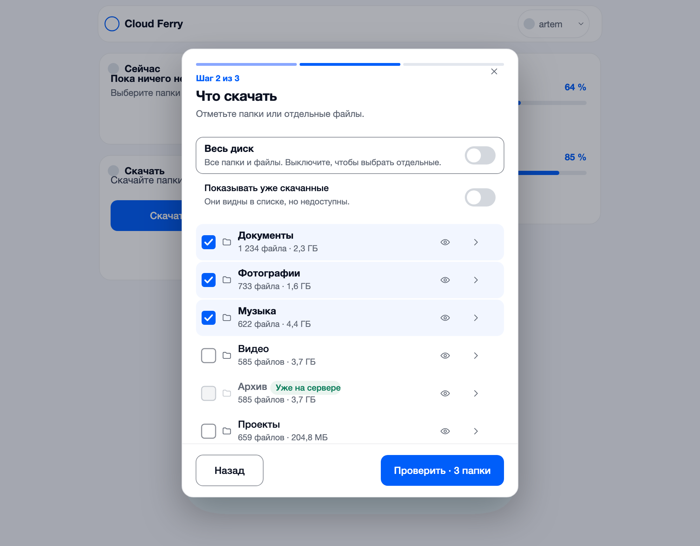
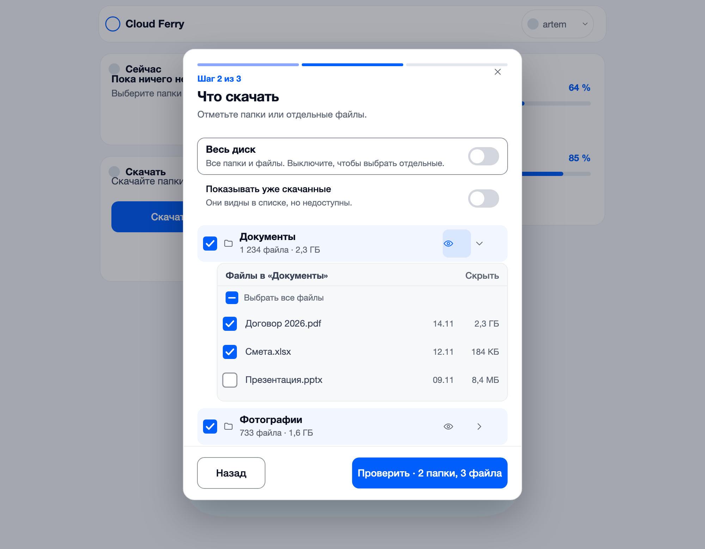
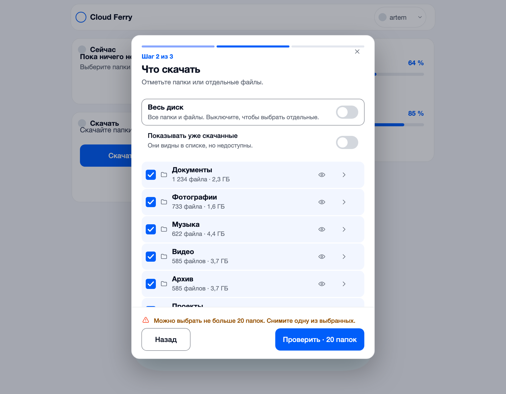
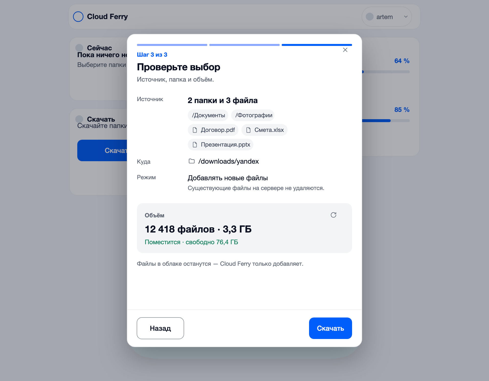
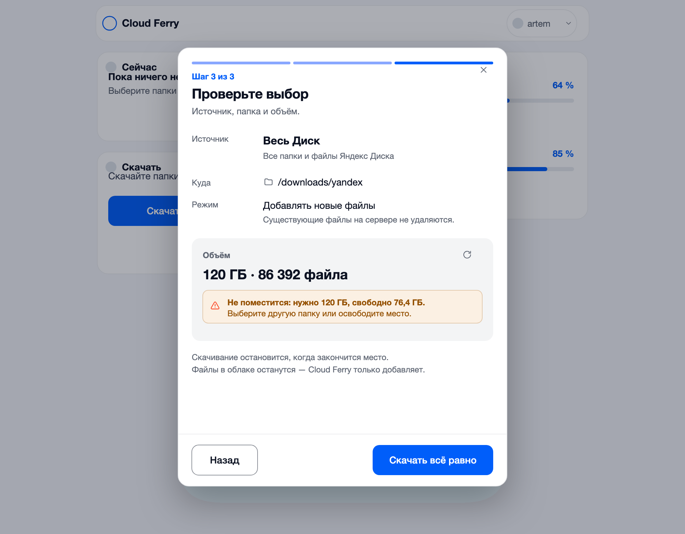
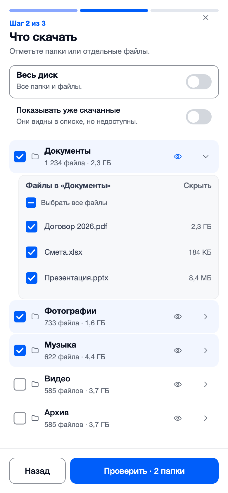

# Cloud Ferry — сквозной флоу «Новое скачивание», дизайн v2

**Снимок:** рабочее дерево 0.2.3, HEAD `6771911` (15.11.2026, 01:05 MSK); последний коммит, менявший флоу, — `94ae0f9`. Все утверждения о текущем поведении сверены с кодом `internal/httpapi/web/{app.js,index.html,style.css}` и серверными ручками; скриншоты — `docs/final7/flow-*.png` и `docs/final8/download-*.png`.
**Границы:** код приложения не менялся, `docs/final*` не трогал. Артефакты — этот документ и [`docs/design/flow-assets`](flow-assets).
**Рабочее дерево менялось параллельно:** после ~00:59 вне моего объёма правятся `internal/httpapi/web/{app.js,index.html,style.css}` и перегенерируются кадры `docs/final8/download-*` (в 01:00+). **§1 описывает состояние до этих правок** — коммит `6771911` и рабочее дерево на 00:50–01:00, то есть ровно то поведение, которое перечислено в брифе и ревью. Перед реализацией сверяйте факты с текущим деревом; выводы дизайна от этого не меняются.
**Как читать:** px — CSS-пиксели при `devicePixelRatio = 1`, ширина × высота в подписях («1000×780») — вьюпорт. Порядок разделов: **A** карта экранов, **B** компоновки 1440/1000/390, **C** компоненты, **D** микрокопия, **E** состояния, **F** движение, **G** доступность, **H** приоритеты, **I** макеты. Раздел 1 — факты, на которых всё построено; раздел 0 — решения.

---

## 0. Что меняется: девять решений

| # | Проблема (бриф) | Решение в v2 | Эффект, измеримо |
|---|---|---|---|
| 1 | 20 чипов съедают экран, кнопки уезжают | Лента чипов и счётчик «Выбрано: N из 20» удалены; выбор виден только галочками в дереве. Футер прибит (`flex: none`), скроллится только тело. Сообщение о лимите — отдельной строкой в футере, над кнопками | У источника освобождается ~260 px высоты (в кадре `final7/flow-step1-limit-1000.png` блок чипов начинается на y = 266 и занимает 7 строк по 32 px + gap 6); футер 76/102 px виден всегда |
| 2 | Четыре конкурирующих действия в футере | В футере максимум 2 кнопки: шаг 1 — только primary; шаги 2–3 — «Назад» + primary. «Создать папку» → текстовая кнопка «+ Новая папка» в теле. «Отмена» → X (44×44) + Esc | Шаг 1: 3 видимых действия → 1; шаг 2: 3 → 2; на 390 футер 124 → 76 px (−48) |
| 3 | Свободное место в двух шагах | Только шаг 3, одна строка внутри блока объёма: «Поместится · свободно 76,4 ГБ». Из шага 1 `folder-free` удалён | Два упоминания → одно; на 390 шаг 1 короче на 18 px (свободное место занимало отдельную строку) |
| 4 | «Узнать объём» — лишний клик | `POST /api/preflight` автоматически при входе на шаг 3; кнопка-иконка ↻ 44×44 — только для повтора/обновления | −1 клик; скелетон начинается сразу после открытия |
| 5 | Нет выбора отдельных файлов | Чекбоксы файлов в панели «Показать файлы»; запрос уходит в `sourceFiles` (сервер уже принимает до 100 файлов вместе с 20 папками) | Новый сценарий; дерево не усложняется — файлы живут в раскрытой панели |
| 6 | Непонятно, чем «Далее» на шаге 1 отличается от выбора папки | Primary называет результат: «Сохранить сюда» (шаг 1) и «Проверить · 3 папки» (шаг 2). Пояснение шапки говорит, что будет дальше, подсказка под путём учит навигации | Кнопка отвечает «что произойдёт», а не «куда нажать» |
| 7 | Не покрыты состояния | Единая таблица E на 40 состояний + скелетоны, пустые, ошибки, лимиты, частичные ответы, таймаут объёма | Каждое состояние имеет текст, иконку и действие |
| 8 | Шаг 3 уже 480, шаги 1–2 — 440; диалог «прыгает» | Все три шага — один диалог 480×640 (на ≤640 — полноэкранный лист 390×844) | Ширина не меняется между шагами (−40 px скачка), высота фиксирована — футер на месте |
| 9 | Палитра/контраст | Primary `#005EFA` (5,27:1 на белом), границы контролов `rgba(16,24,40,.48)` (3,20:1 вместо 1,61:1), оранжевый `#FC3F1D` — только графика предупреждений (3,58:1) | Все интерактивные границы ≥ 3:1 (WCAG 1.4.11) |

**Чего в v2 нет и почему:** режима «Как в облаке» (UI всегда отправляет `mode: "copy"`), удаления файлов, истории скачиваний, «уже скачано» для отдельных файлов (ручка `/api/jobs/existing` принимает только папки), пагинации файлов сверх 200 (ручка отдаёт максимум 200). Подробнее — приложение A.

---

## 1. Факты: что проверено по коду и кадрам

### 1.1 Текущая механика

| Факт | Где подтверждается |
|---|---|
| Шаг 1 — **«Куда сохранить»** (пикер сервера), шаг 2 — **«Что скачать»** (дерево облака), шаг 3 — **«Проверка»** | `openFlowStart()` → `openFolderDialog('server', …, 'flow-dest')`; `updateFolderChrome()`: `destStep ? 'Шаг 1 из 3' : 'Шаг 2 из 3'` |
| Один `<dialog id="folder-dialog">` обслуживает шаги 1–2; шаг 3 — отдельный `<dialog id="review-dialog">` | `index.html`, разметка `#folder-dialog` / `#review-dialog` |
| В футере DOM до 4 кнопок (`#folder-back`, `#folder-create`, «Отмена», `#folder-choose`), но видимых на шаге — **3**: шаг 1 «Создать папку» + «Отмена» + «Далее», шаг 2 «Назад» + «Отмена» + «Далее». При раскрытой форме создания добавляются поле, «Создать», «Отмена» — до 5 контролов. На 390 `.modal-foot` переносится в 2 строки (124 px) | `renderFolderFooter()`, `updateFolderCreateUI()`, `#folder-create-panel`, `#folder-dialog[data-step]`; кадр `final7/flow-step2-390.png` |
| Лимит папок — 20 (`MAX_SOURCE_FOLDERS`), сервер — `maxSourcePaths = 20`; сервер дополнительно принимает `sourceFiles` до 100; комбинированный запрос — до 120 элементов | `app.js`; `internal/httpapi/sources.go` (`maxSourcePaths`, `maxSourceFiles`), `server.go` (`preflightRequest`, `createJobRequest` с `SourceFiles`) |
| UI **не отправляет** `sourceFiles`: `startTransfer()` и `reviewEstimate()` собирают только `sourcePaths` | `app.js`, `sourcePaths` в теле `POST /api/jobs` и `POST /api/preflight` |
| `POST /api/preflight` вызывается только по кнопке «Узнать объём»; при `openReview()` запроса нет | `openReview()` не вызывает `reviewEstimate()`; единственный вызов — listener `#review-estimate` |
| Таймауты: клиент 600 000 мс (`API_TIMEOUT.preflight`), сервер — `contextWithTimeout(r, 10*time.Minute)`; ответ `{files, bytes, free, fits}`; `fits` считается по 90 % свободного места (`disk.TransferLimit`) | `app.js`, `internal/httpapi/server.go` (`handlePreflight`) |
| Свободное место показывается в шаге 1 (`renderFolderCrumbs()`, `.folder-free`: «Свободно 76,4 ГБ») и на шаге 3 (строка «Свободно» + «Поместится: свободно …») | `app.js`; кадры `final8/download-dest-1000.png`, `final8/download-review-1000.png` |
| Чипы и счётчик: `.chip` 32 px, gap 6, `#folder-count` с `role="status" aria-live="polite"`; при 20 папках — 7 строк ≈ 260 px, блок начинается на y = 266 | `renderFlowSourceBar()`, `style.css`; неизменённый кадр `final7/flow-step1-limit-1000.png` (00:27) |
| Причина тупика лимита: `.flow-source` (переключатели + чипы) — не скроллируемый брат `.folder-body`; `.modal { max-height: 640; overflow: hidden }`, поэтому футер выталкивается за границу и обрезается. В кадре лимита primary не виден | `style.css` (`.modal`, `.flow-source`, `.folder-body`, `.modal-foot`); неизменённый кадр `final7/flow-step1-limit-1000.png` (00:27) — синих пикселей primary в нём нет |
| «Показать файлы»: `GET /api/accounts/{id}/files?path=&limit=` → `{path, files:[{name,size,modified}], truncated, count}`. `count` — **число файлов в ответе**, не всего в папке. Лимит по умолчанию 50, максимум 200; кэш 2 мин; UI запрашивает 50 | `internal/httpapi/files.go`; `requestCloudFiles()` (`CLOUD_FILES_LIMIT = 50`) |
| «Уже скачано»: `POST /api/jobs/existing` принимает **только `sourcePaths`** (папки) и возвращает `{exists, entries}` — число элементов верхнего уровня; ошибка уровня не блокирует выбор | `internal/httpapi/existing.go`; `requestExisting()` |
| Размеры папок: `POST /api/cloud/sizes`, ≤20 путей за запрос, 4 параллельно, таймаут пачки 25 с, кэш 10 мин, ошибка одного пути — `{error}` в элементе; UI показывает «…» до ответа и полностью скрывает размеры на 404/405 | `internal/httpapi/sizes.go`; `requestCloudSizes()`, `folderSizeText()` |
| Состояние флоу — переменные модуля: `flowStep`, `flowSourceAll` (по умолчанию **`true`** — «Весь диск» включён), `cloudSelection`, `flowDest`, `flowFree`, `flowTotal`, `flowShowExisting`, `flowPreflight` | `app.js`, блок «П2: три шага и проверка» |
| Выбор переживает закрытие диалога и повторный вход (память страницы); сбрасывается после успешного старта и при смене аккаунта; раскрытие дерева и скролл — не переживают, т. к. `showFolderStep()` создаёт `folder` заново | `openFlowStart()`, `startTransfer()`, `finishFolderDialog()`, `syncSelectionAccount()` |
| Старт: `POST /api/jobs` с `mode: "copy"`; 409 при конфликте пути; `needs-auth` проверяется до старта | `startTransfer()`; `server.go` (`handleCreateJob`) |

### 1.2 Расхождения с предыдущим ревью (учитывать при чтении `design-review.md`)

1. **Шаги в `design-review.md` §1.5–1.6 названы наоборот** относительно текущего кода: шаг 1 — назначение, шаг 2 — источник. Кадры `final7/flow-step1-*` (там «Что скачать» на шаге 1) сняты до переупорядочивания; актуальные — `final8/download-dest-*.png` / `download-source-*.png`. В v2 порядок шагов сохранён как в коде.
2. «Четыре действия в футере» — в DOM четыре кнопки (`#folder-back`, `#folder-create`, «Отмена», `#folder-choose`), видимых на шаге — три: на шаге назначения «Создать папку» + «Отмена» + «Далее», на шаге источника «Назад» + «Отмена» + «Далее». При открытой инлайн-форме создания контролов в футере становится 5. Проблема реальна, но точнее: «3 кнопки + X, на 390 — две строки».
3. `design-review.md` §1.7 предлагал «Назад» + «Скачать» — принято; кнопку «Обновить объём» переносим в блок объёма иконкой.
4. Предложение «Выбрать папку» для primary шага 1 не подходит: кнопка подтверждает текущую папку и ведёт дальше, поэтому «Сохранить сюда».
5. Прочтение `count` в `/api/accounts/{id}/files` как «всего файлов в папке» некорректно: это размер ответа (≤ limit), общего числа ручка не сообщает — поэтому текст «Показаны первые 200 файлов», без «из N».
6. «Уже скачано» для отдельных файлов спроектировать нельзя: ручка проверяет только папки, а `/files` не содержит признака наличия на сервере. В v2 такого индикатора нет.

### 1.3 Снимок и параллельные изменения

| Что | Наблюдение |
|---|---|
| HEAD | `6771911` («Pin 0.2.3 image digest») — не менялся |
| Рабочее дерево на 00:50 | состояние, описанное в §1.1: чипы/счётчик, 3 кнопки в футере, свободное место на шаге 1, `sourceFiles` не отправляется, preflight по кнопке |
| После 00:59 | вне моего объёма правятся `app.js`, `index.html`, `style.css` (новый каркас диалога, `selectedFiles`, лимит у строки, авто-preflight) и перегенерируются `docs/final8/download-*`; кадр `download-source-limit-1000.png` в 01:00 уже показывает футер |
| Что это значит | Факты §1 — снимок до правок, они объясняют, **почему** дизайн такой. Перед реализацией сверяйте с текущим деревом; при расхождении приоритет у текущего кода |

---

## A. Карта экранов и переходов

### A.1 Схема

```
Главный экран
  └─ карточка «Скачать» → [Скачать]  ── openFlowStart(trigger)
        │
        ▼
  ┌───────────────────────────── #folder-dialog (480×640) ─────────────────────────────┐
  │ Шаг 1 «Куда сохранить»  ── primary «Сохранить сюда» ──▶  flowDest = текущая папка   │
  │   пикер сервера, одна папка                                                         │
  │        │ «Наверх»/строки — навигация, primary — подтверждение                       │
  │        ▼                                                                            │
  │ Шаг 2 «Что скачать»     ── primary «Проверить · N» ──▶  cloudSelection / files      │
  │   «Весь диск», фильтр, дерево папок, панели файлов                                  │
  │        │ «Назад» → шаг 1 (выбор сохраняется)                                        │
  └────────┼────────────────────────────────────────────────────────────────────────────┘
           ▼
  ┌────────────── #review-dialog (480×640) ──────────────┐
  │ Шаг 3 «Проверьте выбор»                              │
  │   вход → AUTO POST /api/preflight (key = выбор+путь) │
  │   «Назад» → шаг 2 (дерево и выбор сохраняются)       │
  │   «Скачать» → POST /api/jobs {mode:"copy"}           │
  └──────────┬───────────────────────────────────────────┘
             │ успех: диалог закрыт, тост «Скачивание началось»,
             │        фокус на заголовок «Сейчас»
             ▼
        Главный экран (задание в «Сейчас»)
```

### A.2 Переходы

| Из | Действие пользователя | Куда | Что происходит с состоянием | Обратная связь |
|---|---|---|---|---|
| Главный | «Скачать» в карточке | Шаг 1 | `flowOpener` = кнопка; `flowShowExisting = false`; кэш «уже скачано» очищен; `flowDest` подставляется из прошлого выбора / `state.downloads` | Диалог: backdrop 120 мс, панель 140 мс; фокус на `h2` |
| Шаг 1 | primary «Сохранить сюда» | Шаг 2 | `flowDest` = `displayPath(folder.path)`; `flowFree/flowTotal` запоминаются (нужны шагу 3) | Смена контента 140 мс; заголовок шага 2 в фокусе |
| Шаг 1 | клик по строке папки / «На уровень выше» | Шаг 1 (внутри) | `folder.path` меняется, `flowDest` ещё не подтверждён | Скелетон списка 3 строки; фокус на первую строку |
| Шаг 1 | «+ Новая папка» → «Создать» | Шаг 1 (внутри) | После `POST /api/fs/dirs` папка открывается и становится текущей; primary активна | Инлайн-ошибка под полем; тост «Папка «…» создана» |
| Шаг 1 | X / Esc | Главный | Черновик (flowDest, выбор источника) остаётся в памяти | Фокус на `flowOpener` |
| Шаг 2 | «Назад» | Шаг 1 | `flowSourceAll`, `cloudSelection`, `selectedFiles` сохраняются | Заголовок шага 1 в фокусе |
| Шаг 2 | «Весь диск» вкл/выкл | Шаг 2 (внутри) | `folder.all`; выбор папок не теряется, чекбоксы недоступны при вкл | Список перерисовывается; фокус на переключателе |
| Шаг 2 | eye «Показать файлы» | Шаг 2, панель под строкой | `folder.preview = {path,status}`; повторное открытие — из кэша (2 мин на сервере, `folder.files` в памяти) | Скелетон 3 строки 12 px; фокус остаётся на eye |
| Шаг 2 | чекбокс 21-й папки | Шаг 2 | Папка **не** выбирается; `limitError` в футере | `role="alert"`: «Можно выбрать не больше 20 папок. Снимите одну из выбранных.» Фокус не сбрасывается |
| Шаг 2 | primary «Проверить · N» при пустом выборе | Шаг 2 | Ошибка над кнопками: «Выберите папки, файлы или включите «Весь диск».»; фокус на первое поле/чекбокс | `role="alert"` |
| Шаг 2 | primary валиден | Шаг 3 | `cloudSelection` = выбранные папки (сортировка), `selectedFiles` = файлы; `flowPreflight.key` = `folders/files + flowDest`; диалог шага 2 закрывается | Смена диалога: старый закрывается, новый открывается 140 мс |
| Шаг 3 | вход | Шаг 3 | Если `flowPreflight.key` изменился — сброс и **авто-запрос**; если нет — показывается готовый результат | Скелетон → значение; `announce()` один раз: «Объём: 12 418 файлов · 3,3 ГБ» |
| Шаг 3 | «Назад» | Шаг 2 | Дерево открывается на корне (см. A.4 — предлагается сохранять раскрытие); выбор сохранён; результат preflight кэширован по key | Заголовок шага 2 в фокусе |
| Шаг 3 | «Скачать» | Главный | `flowBusy = true`: X и «Назад» заблокированы (`aria-disabled`), primary с спиннером; после успеха состояние выбора сбрасывается | Тост «Скачивание началось: 3 папки → /downloads»; фокус на `#now-title` |
| Шаг 3 | ошибка старта | Шаг 3 | Остаёмся, кнопки снова активны, выбор сохранён | `#review-error` `role="alert"` + фокус на ошибку |
| Любой | смена hash / уход со страницы | — | `closeDialogsForRoute()` закрывает диалоги; `pagehide` не влияет на preflight | — |
| Любой | `needs-auth` до старта | Главный | Тост «Нужно войти заново» + действие «Войти заново» → `#/setup` | Тост, 6 с |

**Повторный вход.** Закрытие X — это отмена, но не очистка: следующий вход начинается с шага 1 с сохранённым назначением; на шаге 2 ранее отмеченные папки/файлы отмечены. Сброс — после успешного старта, при смене аккаунта (`syncSelectionAccount`) и при перезагрузке страницы.

### A.3 Где живёт состояние

| Что | Где | Время жизни | Сброс |
|---|---|---|---|
| `flowStep` | модуль `app.js` | сессия страницы | успешный старт |
| `flowDest`, `flowFree`, `flowTotal` | модуль | до успешного старта/смены аккаунта | успешный старт |
| `flowSourceAll`, `cloudSelection` | модуль | до успешного старта/смены аккаунта | успешный старт, `syncSelectionAccount()` |
| `selectedFiles` (новое, `Map path → {folder,name,size}`) | модуль | как `cloudSelection` | успешный старт, смена аккаунта, снятие папки-родителя |
| `flowShowExisting` | модуль | как сессия флоу | новый вход в флоу (`openFlowStart`) |
| `flowPreflight {key,status,data,error}` | модуль | до смены key | смена `flowDest`/выбора |
| Дерево: `folder.nodes`, `expanded`, `sizes`, `preview`, `files` | `folder` | **только шаг** (создаётся в `showFolderStep`) | каждый переход шаг↔шаг |
| Позиция скролла тела | DOM | шаг | перерисовка |
| Черновик на диск | нет (не сохраняем) | — | — |

**Предложение по реализации (P1):** хранить `expanded`, `preview` и позицию скролла в отдельной структуре «сессии флоу», чтобы «Назад» со шага 3 возвращал ровно то место, откуда ушли. Сейчас `folder` пересоздаётся, дерево схлопывается, а `flowDest`/выбор сохраняются — это уже работает.

### A.4 Что считается «изменением выбора» для авто-объёма

`flowPreflight.key` = `all` (весь диск) или `files: sorted(cloudSelection) + sorted(selectedFiles)`, плюс `flowDest`. Возврат на шаг 2 без изменений → на шаге 3 сразу готовый результат, без повторного запроса: ответ хранится в памяти до смены key (подсчёт на сервере — до 10 минут). Изменение любой папки, файла или пути → key другой → скелетон и новый запрос.

---

## B. Компоновки: 1440 / 1000 / 390

### B.0 Общая рамка

| Ширина экрана | Диалог | Позиция | Шапка | Тело (скролл) | Футер | Боковые отступы контента |
|---|---|---|---|---|---|---|
| **1440×900** | 480×640, r16 | x = 480…960, y = 130…770 | 130…244 (**114**) | 244…694 (**450**) | 694…770 (**76**; с лимитом 668…770 = **102**) | 20 (контент 440) |
| **1000×780** | 480×640, r16 | x = 260…740, y = 70…710 | 70…184 (**114**) | 184…634 (**450**) | 634…710 (**76**; с лимитом 608…710 = **102**) | 20 (контент 440) |
| **≤640 (390×844)** | 390×844, r0 — лист | x = 0…390, y = 0…844 | 0…112 (**112**, c `safe-area-inset-top`) | 112…768 (**656**) | 768…844 (**76**, c `safe-area-inset-bottom`; с лимитом до **120**) | 16 (контент 358) |

Общее: фон страницы `#F3F5F9`, backdrop `rgba(12,18,34,.34)` + `backdrop-filter: blur(2px)`; поверхность `#FFFFFF`, рамка `#E9EAEC` (1 px), тень `0 24px 48px -28px rgba(16,24,40,.28)`, радиус 16. Футер отделён hairline `#ECEDEF` 1 px и **не скроллится**; скроллится только тело (`overscroll-behavior: contain`, `scrollbar-gutter: stable` на десктопе).

**Шапка (одна на все шаги).** Сверху вниз:
1. индикатор шага: 3 сегмента по `(440 − 2·4)/3 = 144` px, высота 4, радиус 2, gap 4; пройденные `#89A7FF`, текущий `#005EFA`, будущие `#E3E7EE`;
2. «Шаг N из 3» — 12/16, 600, `#005EFA`, отступ 10 сверху;
3. заголовок — 20/26, 600, `-0.02em`, `#0C1222`, отступ 4;
4. пояснение — 13/18, `#5F6673`, отступ 4;
5. X — 44×44, иконка 16, `#5F6673`, в правом верхнем углу (top 10, right 12).
Итого шапка 114 (десктоп) / 112 (390). Индикатор — `aria-hidden="true"`; позиция дублируется текстом и `sr-only`.

### B.1 Шаг 1 «Куда сохранить»

```
1000×780 (диалог x=260…740, y=70…710)            [step1-dest-1000.svg]
┌──────────────────────────────────────────────────────────────┐
│ ████████░░░░░░░░░░░░░░░░░░░░░░░░░░░░  stepper 3×144×4      · │ ← 20/20
│ Шаг 1 из 3      12/16 600 #005EFA                   [X 44]  │
│ Куда сохранить  20/26 600                                   │
│ Сюда попадут файлы. Дальше выберете, что скачать. 13/18      │
├──────────────────────────────────────────────────────────────┤ ← y=70+114=184
│ ┌──────────────────────────────────────────────────────────┐ │ +12 → 196
│ │ 16 ▤ /downloads            14/20 600   ↥ На уровень выше │ │ путь 48
│ └──────────────────────────────────────────────────────────┘ │
│ Нажмите на строку, чтобы открыть вложенную папку. 12/16      │ +8 → 252 (16)
│ Содержимое 12/16 600                    + Новая папка        │ +16 → 282 (36)
│                                                              │ +8 → 328
│  ▤ yandex                                                ›   │ 48
│  ▤ фото                                                  ›   │ 48
│  ▤ архив                                                 ›   │ 48
│  ▤ документы                                             ›   │ 48
│  ▤ проекты                                               ›   │ 48   (тело 450, строки 48+2)
│  … пустое место 56 px до футера …                            │
├──────────────────────────────────────────────────────────────┤ ← 634
│                                    [ Сохранить сюда 176×44 ]  │ футер 76
└──────────────────────────────────────────────────────────────┘
390×844 (лист)                                  [компоновка]
┌────────────────────────────────────────┐
│ ████████░░░░░░░░░░░░░░░░░░░░░░░░ 4px  │ ← 16
│ Шаг 1 из 3                        [X]  │
│ Куда сохранить                         │
│ Сюда попадут файлы. Дальше выберете,   │
│ что скачать.                           │
├────────────────────────────────────────┤ ← 112
│ ┌────────────────────────────────────┐ │
│ │ ▤ /downloads            [↥ 44×44] │ │ путь 48
│ └────────────────────────────────────┘ │
│ Нажмите на строку, чтобы открыть       │
│ вложенную папку.                       │
│ Содержимое            + Новая папка    │ ↑ тулбар 44 (тач)
│  ▤ yandex                           ›  │ 56
│  ▤ фото                             ›  │ 56
│  …                                     │
├────────────────────────────────────────┤ ← 768
│ [        Сохранить сюда  358×44      ] │ футер 76
└────────────────────────────────────────┘
```

| Параметр | 1440 | 1000 | 390 |
|---|---|---|---|
| Ширина диалога / контента | 480 / 440 | 480 / 440 | 390 / 358 |
| Путь (панель) | 48 px, рамка 1 px `.48`, r10 | то же | 48 px; «На уровень выше» — иконка 44×44, текст в `aria-label`/`title` |
| Строка папки | 48, r10, icon 16, шеврон в 40 (44 тач) | то же | 56, шеврон 44×44 |
| Подсказка | 12/16, 16 px | то же | переносится до 2 строк |
| Тулбар «+ Новая папка» | 36 (тач 44), 13/18 500 `#005EFA` | то же | 44 |
| Список | 6 полных строк (48 + 2 gap), дальше скролл | то же | 8 полных строк (56 + 2), 9-я частично |
| Футер | 1 кнопка 176×44 справа | то же | 1 кнопка 358×44 (100 %) |
| Форма создания | input 44 + «Создать» 44 + «Отмена» 44 в строку | то же | input 358, кнопки в 2 колонки по 175 |

### B.2 Шаг 2 «Что скачать»

```
1000×780                                        [step2-selected-1000.svg]
┌──────────────────────────────────────────────────────────────┐
│ ████████████████░░░░░░░░  stepper: 1 пройден, 2 текущий      │
│ Шаг 2 из 3                                                  │
│ Что скачать                                                 │
│ Отметьте папки или отдельные файлы.                         │
├──────────────────────────────────────────────────────────────┤ ← 184
│ ┌──────────────────────────────────────────────────────────┐ │ mode 52 (рамка .48)
│ │ Весь диск         14/20 600                    [—○ 44]  │ │
│ │ Все папки и файлы. Выключите, чтобы выбрать отдельные.  │ │
│ └──────────────────────────────────────────────────────────┘ │
│ ····· 8 px ·····                                             │ filter 52 (без рамки)
│ Показывать уже скачанные                         [—○ 44]    │
│ Они видны в списке, но недоступны.                          │
│ ····· 12 px ·····                                            │
│ ☑ ▤ Документы                      1 234 файла · 2,3 ГБ  👁  ›│ 52  выбран
│ ☑ ▤ Фотографии                        733 файла · 1,6 ГБ  👁  ›│ 52  выбран
│ ☑ ▤ Музыка                            622 файла · 4,4 ГБ  👁  ›│ 52  выбран
│ ☐ ▤ Видео                             585 файлов · 3,7 ГБ 👁  ›│ 52
│ ☐ ▤ Архив  [Уже на сервере]           585 файлов · 3,7 ГБ 👁  ›│ 52  недоступен
│ ☐ ▤ Проекты                           659 файлов · 204,8 МБ👁  ›│ 52  (обрезана на 8 px)
├──────────────────────────────────────────────────────────────┤ ← 634
│ [Назад 96]                     [ Проверить · 3 папки 176 ]   │ футер 76
└──────────────────────────────────────────────────────────────┘

390×844                                  [step2-selected-390.svg]
┌────────────────────────────────────────┐
│ ████████████████░░░░░░░░░ 4px          │ ← 16
│ Шаг 2 из 3                        [X]  │
│ Что скачать                            │
│ Отметьте папки или отдельные файлы.    │
├────────────────────────────────────────┤ ← 112
│ ┌────────────────────────────────────┐ │ mode 56
│ │ Весь диск                  [—○ 44] │ │
│ │ Все папки и файлы.                 │ │
│ └────────────────────────────────────┘ │
│ Показывать уже скачанные      [—○ 44]  │ filter 56
│ Они видны в списке, но недоступны.     │
│ ☑ ▤ Документы          👁 44     › 44  │ 56
│   ┌──────────────────────────────────┐ │
│   │ Файлы в «Документы»       Скрыть │ │ панель
│   │ ☑ Выбрать все файлы              │ │
│   │ ☑ Договор 2026.pdf      2,3 ГБ   │ │ 44
│   │ ☑ Смета.xlsx            184 КБ   │ │ 44
│   │ ☑ Презентация.pptx      8,4 МБ   │ │ 44
│   └──────────────────────────────────┘ │
│ ☑ ▤ Фотографии         👁 44     › 44  │ 56
│ …                                      │
├────────────────────────────────────────┤ ← 768
│ [Назад 96] [ Проверить · 2 папки 254 ] │ футер 76
└────────────────────────────────────────┘
```

| Параметр | 1440 | 1000 | 390 |
|---|---|---|---|
| Переключатель «Весь диск» | 52, рамка `.48`, r10, padding 8 12; тумблер 44×26 | то же | 56 |
| Фильтр «Показывать уже скачанные» | 52, без рамки, padding 8 12 | то же | 56 |
| Строка дерева | 52; чекбокс 20, иконка 16, имя 14/20, мета 12/16, eye 40, шеврон 40 | то же | 56; eye/шеврон 44×44 |
| Панель файлов | отступ слева 28, r10, фон `#F7F8FA`, рамка hairline, padding 12 | то же | полная ширина строки −28 слева |
| Строка файла | 40; чекбокс 20, имя 13/18, размер 12/16 mono, дата 12/16 | то же | 44; дата скрыта (<480) |
| Видимых строк | 5 полных + 6-я обрезана на 8 px | то же | 8 полных + 9-я частично (без панели) |
| Футер | «Назад» 96 + primary по тексту (176…240) | то же | «Назад» 96 + primary flex (254) |
| Футер с лимитом | 102: alert 18 + 8 + кнопки 44 + 32 padding | то же | до 120 (alert в 2 строки), кнопки в той же строке |

### B.3 Шаг 3 «Проверьте выбор»

```
1000×780                                       [step3-review-1000.svg]
┌──────────────────────────────────────────────────────────────┐
│ ████████████████████████████  stepper: 1–2 пройдены          │
│ Шаг 3 из 3                                                  │
│ Проверьте выбор                                             │
│ Источник, папка и объём.                                    │
├──────────────────────────────────────────────────────────────┤ ← 184
│ Источник   2 папки и 3 файла          16/22 600             │
│            [/Документы] [/Фотографии]                       │
│            [📄 Договор.pdf] [📄 Смета.xlsx]                 │
│            [📄 Презентация.pptx]                             │
│ Куда       ▤ /downloads/yandex        14/20                 │
│ Режим      Добавлять новые файлы      14/20                 │
│            Существующие файлы на сервере не удаляются. 12/16│
│ ┌──────────────────────────────────────────────────────────┐ │ 102
│ │ Объём                                                  ↻  │ │
│ │ 12 418 файлов · 3,3 ГБ   20/24 600                       │ │
│ │ Поместится · свободно 76,4 ГБ   13/18 #067A57            │ │
│ └──────────────────────────────────────────────────────────┘ │
│ Файлы в облаке останутся — Cloud Ferry только добавляет.     │
│                                                              │
│ (пустое место тела — 118 px; футер не двигается)             │
├──────────────────────────────────────────────────────────────┤ ← 634
│ [Назад 96]                                       [Скачать 88]│
└──────────────────────────────────────────────────────────────┘
```

| Параметр | 1440 | 1000 | 390 |
|---|---|---|---|
| Колонка меток / отступ значения | 92 + 12 = 124 | то же | 92 из 358 → значение 124…374 |
| Чипы источника | 24 px, r12, 12/16; показываем до 6 папок и до 6 файлов, остальные — «+N» 44; файлы — с иконкой 14 | то же | те же 6 + 6, перенос по ширине |
| Блок объёма | 440×102 (ready), 150 (nofit), ≈160 (считаем), padding 16, r12, `#F3F4F5` | то же | 358 ширина |
| Значение объёма | 20/26 600, `tabular-nums` | то же | 20/26 |
| ↻ | 36 (44 тач) в правом верхнем углу блока | то же | 44 |
| Футер | «Назад» 96 + «Скачать» 88 | то же | primary flex 254 |

**Nofit:** блок объёма 150 px: значение + предупреждение (2 строки, 12/16 `#945000` на `#FBF0E3`, рамка `#E3C9AC`), primary меняет текст на «Скачать всё равно» (176). **Считаем:** скелетон (2 полосы 24 и 14, ширина 40 % и 60 %) + «Считаем файлы и объём…» 13/18 + подпись 12/16.

### B.4 Правила скролла и футера (все ширины)

1. `.flow-dialog { display:flex; flex-direction:column; height:min(640px,100dvh-48px) }`; шапка и футер — `flex:none`; тело — `flex:1 1 auto; min-height:0; overflow-y:auto`.
2. Сообщение о лимите и ошибка выбора — часть футера (над кнопками), а не тела: они не могут уехать за экран.
3. Одна строка футера: `display:flex; gap:8; align-items:center`; primary прижат вправо на десктопе, растянут на 390. На 390 — `flex-wrap: nowrap`, никаких двух строк.
4. Высота футера фиксирована: 76; с alert 102 (desktop, 1 строка) до 120 (390, 2 строки). Тело пересчитывается, кнопки не двигаются.
5. Тело не анимирует высоту; смена шага — только crossfade контента (F).
6. `scrollbar-gutter: stable` на ≥641, чтобы контент не дёргался при появлении скролла; на 390 скроллбар скрыт (нативный overlay).

---

## C. Спецификация компонентов

### C.1 Токены

**Цвета** (контраст — WCAG 2.2, альфа-композитинг на реальных фонах).

| Токен | Значение | Где | Контраст |
|---|---|---|---|
| `--accent` | `#005EFA` | primary, ссылки, отмеченный чекбокс, текущий сегмент шага | 5,27:1 на `#FFFFFF`, 4,83:1 на `#F3F5F9` |
| `--accent-hover` | `#0052D6` | hover/active primary | 6,61:1 на белом |
| `--accent-soft` | `rgba(0,94,250,.10)` | фон отмеченной строки, hover иконочных кнопок | — |
| `--step-done` | `#89A7FF` | пройденный сегмент шага (**только графика**) | 2,32:1 — текст этим цветом запрещён |
| `--focus` | `#0059BD` | `outline` при `:focus-visible` | 6,64:1 |
| `--ink` | `#0C1222` | заголовки, значения, имена | 18,66:1 |
| `--ink-soft` | `#3A4256` | плотный вторичный текст, чипы | 10,03:1 |
| `--muted` | `#5F6673` | мета, пояснения, placeholder-подписи | 5,78:1 |
| `--hairline` | `rgba(16,24,40,.08)` | разделитель футера, рамка панели файлов | декоративная |
| `--border-control` | `rgba(16,24,40,.48)` | рамки полей, вторичных кнопок, строки «Весь диск» | **3,20:1** (было `.22` = 1,61:1 — не проходило 1.4.11) |
| `--sunken` | `rgba(16,24,40,.05)` | фон блока объёма, чипов, disabled-чекбокса | — |
| `--ok` / `--ok-tint` | `#067A57` / `rgba(6,122,87,.09)` | «Поместится», тег «Уже на сервере» | 4,82:1 на `#F3F3F4` |
| `--amber` / `--amber-tint` / `--amber-border` | `#945000` / `rgba(196,109,0,.10)` / `rgba(148,80,0,.26)` | лимит, ошибки, nofit | 6,16:1 на белом, 5,47:1 на тинте |
| `--orange` | `#FC3F1D` | **только иконка** предупреждения/иллюстрации | 3,58:1 (графика ≥ 3:1), для текста не использовать |
| `--surface` / `--page` | `#FFFFFF` / `#F3F5F9` | поверхность диалога / фон страницы | — |

**Типографика** — 6 размеров (было 8):

| Токен | Размер/интерлиньяж | Вес | Где |
|---|---|---|---|
| caption | 12/16 | 500 | лимит, мета, подписи, теги, даты, счётчики |
| secondary | 13/18 | 400 | пояснения шапки, ошибки, подсказки |
| body | 14/20 | 400/500/600 | строки, поля, кнопки, значения «Куда» |
| section | 16/22 | 600 | значение «Источник», заголовки блоков |
| title | 20/26 | 600, `-.02em` | заголовок шага, значение объёма |
| metric | 24/30 | 600, `-.02em` | пока не используется во флоу (зарезервирован) |

Числа — `font-variant-numeric: tabular-nums` (размеры, счётчики, килобайты, даты).

**Отступы:** 4/8/12/16/20/24. Внутри компонента 8–12, между группами 12–16, поля диалога 20 (16 на 390). **Радиусы:** 4 (чекбокс), 8 (иконочная кнопка, warning-панель), 10 (строка, поле, кнопка), 12 (чип, блок объёма), 16 (диалог), 999 (тумблер). **Тени:** панель `0 24px 48px -28px rgba(16,24,40,.28)`; больше теней во флоу нет.

### C.2 Индикатор шага

| Свойство | Значение |
|---|---|
| Раскладка | 3 сегмента в ряд, ширина `(ширина контента − 8)/3`, высота 4, gap 4, радиус 2 |
| Цвета | пройден `#89A7FF`, текущий `#005EFA`, будущий `#E3E7EE` |
| Текст | «Шаг N из 3» 12/16, 600, `#005EFA`, отступ 10 от полосы |
| Поведение | только отображение; переход 180 мс `background-color` |
| Доступность | полосы `aria-hidden="true"`; для скринридера — `sr-only` «Шаг N из 3» в `aria-describedby` заголовка |

### C.3 Шапка диалога

| Свойство | Значение |
|---|---|
| Padding | 20 20 12 (390: `max(16, safe-top) 16 12`) |
| Высота | 114 (390: 112), `flex: none` |
| Заголовок | `h2` 20/26 600, `-0.02em`, `tabindex="-1"`, фокус ставится при открытии шага |
| Пояснение | 13/18 `#5F6673`, отступ 4; на 390 переносится до 2 строк |
| X | кнопка 44×44, иконка 16, `aria-label="Закрыть"`, top 10 / right 12; на 390 — 44×44 |
| Busy | `aria-busy="true"` на диалоге во время старта; X и «Назад» — `aria-disabled`, Esc игнорируется |

### C.4 Панель пути и «На уровень выше»

| Свойство | Значение |
|---|---|
| Контейнер | 440×48 (390: 358×48), r10, рамка 1 px `--border-control`, padding 0 12, `grid: 16 1fr auto`, gap 8 |
| Иконка | `folder` 16 `#5F6673` |
| Путь | 14/20, 600, `#0C1222`, `text-overflow: ellipsis`, `title` = полный путь |
| «На уровень выше» | тихая кнопка: иконка `chevron-up` 16 + текст 13/18 500 `#005EFA`, высота 44, padding 0 8; у корня — `aria-disabled="true"`, opacity .5 |
| 390 | только иконка 44×44, `aria-label="На уровень выше"`, `title` тот же |
| Поведение | клик грузит родителя; при загрузке — skeleton строк; ошибка — в теле |

### C.5 Тулбар и создание папки

| Свойство | Значение |
|---|---|
| Тулбар | 36 px (390: 44), отступ 16 сверху; слева «Содержимое» 12/16 600 `#5F6673`, справа «+ Новая папка» |
| «+ Новая папка» | иконка `plus` 16 + текст 13/18 500 `#005EFA`; высота 44 (визуально 36 на десктопе), padding 0 8; при недоступном API скрыта |
| Форма создания | поле 44 (placeholder «Название папки», `aria-label="Название папки"`) + «Создать» 44 + «Отмена» 44; desktop — в строку, 390 — поле на всю ширину, кнопки 2 колонки |
| Ошибка | 12/16 `#945000` + иконка 16, `aria-invalid` + `aria-describedby` на поле; фокус остаётся в поле |
| Максимум | 255 символов, без `/`, `.`, `..` (валидация уже есть) |
| Успех | папка создана и открыта; тост «Папка «…» создана»; primary активна |

### C.6 Строка навигации по серверу

| Свойство | Значение |
|---|---|
| Высота | 48 (390: 56), r10, padding 0 8 0 10 |
| Раскладка | `16 (icon) 1fr 40 (chevron)`, gap 12 |
| Текст | 14/20 400 `#0C1222`, ellipsis, `title` |
| Шеврон | `chevron-right` 16 в кнопке 40×40 (44 на coarse/390) |
| Состояния | hover фон `--sunken`; focus — outline 2 px `--focus`, offset −2 (внутрь строки); disabled нет |
| Семантика | `<button type="button">` (навигация, не выбор) |

### C.7 Переключатели режимов

| Элемент | Свойство | Значение |
|---|---|---|
| «Весь диск» | контейнер | 52 px (390: 56), r10, рамка 1 px `--border-control`, padding 8 12; весь контейнер — `<label>` |
| | заголовок | 14/20 600 `#0C1222` |
| | пояснение | 12/16 `#5F6673`: «Все папки и файлы. Выключите, чтобы выбрать отдельные.» (390: «Все папки и файлы.») |
| | тумблер | track 44×26 r13; off `#D3D7DD`, on `#005EFA`; knob 20 `#FFFFFF`; смена 160 мс; focus-ring `outline 2px #0059BD` на track |
| Фильтр «Показывать уже скачанные» | контейнер | 52 (390: 56), без рамки, padding 8 12; `<label>` целиком |
| | заголовок | 13/18 500 |
| | пояснение | 12/16: off «Они видны в списке, но недоступны.», on «Можно выбрать — будут перекачаны.» |
| | тумблер | тот же, 44×26 |
| Поведение | «Весь диск» выключен → чекбоксы дерева активны; включён → недоступны, уже отмеченные папки не сбрасываются; фильтр скрыт в режиме «Весь диск» и при недоступном API | |

### C.8 Строка папки в облаке (дерево)

| Свойство | Значение |
|---|---|
| Раскладка | `grid-template-columns: 20px 16px minmax(0,1fr) 40px 40px; gap: 8px 8px;` padding 4 8; min-height 52 (390: 56); r10 |
| Чекбокс | 20×20 (см. C.9) — первый столбец; кликается вся строка-`label`, кроме кнопок действий |
| Иконка | `folder` 16 `#5F6673` (у недоступной — `#C7CBD1`) |
| Имя | 14/20; 400 обычно, 600 у отмеченной; ellipsis, `title` = полный путь |
| Мета | вторая строка под именем: 12/16 `#5F6673`, `tabular-nums`: «1 234 файла · 2,3 ГБ»; при недоступных размерах не показывается; до ответа — «…» |
| Тег | после имени в той же строке, 20 px (C.10) |
| «Показать файлы» | `eye` 16 в кнопке 40×40 (44); `aria-expanded`, `aria-controls="folder-files-<path>"`, `aria-label="Показать файлы в папке «…»"`; открытая — фон `--accent-soft`, иконка `--accent` |
| Раскрытие | `chevron` 16 в кнопке 40×40 (44), `aria-expanded`, `aria-label="Показать папки внутри «…»"`; закрыто — `rotate(-90deg)` (вправо), открыто — 0; поворот 160 мс |
| Вложенность | `<ul class="folder-children">` внутри `<li>`, отступ 20, вертикальная линия 1 px `rgba(16,24,40,.06)` слева — только визуальная глубина |
| Выбранная | фон `--accent-soft`, имя 600; снятая — без фона |
| Недоступная | имя `#5F6673`, чекбокс disabled, hover выключен; причина — тегом и `aria-describedby` |
| Фокус | outline 2 px `--focus`, offset −2; чекбокс в фокусе — ring вокруг «марки» |
| Семантика | вложенные `ul/li` + `label` + нативный `input[type=checkbox]`; никакого `role="tree"` — иерархия читается списками |

### C.9 Чекбокс

| Состояние | Визуал | Семантика |
|---|---|---|
| off | 20×20, r4, рамка 1,5 px `#8C9098`, фон `#FFFFFF` | `input[type=checkbox]` + `aria-label` строки |
| on | фон `#005EFA`, белая галочка (5×10, stroke 2) | `checked` |
| mixed | фон `#005EFA`, белая полоса 10×2 | `indeterminate`; снимается кликом, ставит on |
| disabled off | рамка `#C7CBD1`, фон `#F3F4F5` | `disabled aria-disabled="true"`, `aria-describedby` на тег с причиной |
| disabled on | фон `#8FA9DE`, галочка | то же; означает «отмечено, но сейчас недоступно» |
| focus | `outline 2px #0059BD; outline-offset: 2px` на видимой «марке» | `:focus-visible` |
| Тач | визуал 20, цель — вся строка 52/56 | — |

### C.10 Теги строки

| Тег | Когда | Цвета |
|---|---|---|
| «Уже на сервере» | `exists && entries > 0`, фильтр выключен | `#067A57` на `rgba(6,122,87,.09)` |
| «Будет перекачано» | то же, фильтр включён | `#005EFA` на `rgba(0,94,250,.10)` |
| «Пустая папка на сервере» | `exists && entries === 0` (выбирать можно) | `#5F6673` на `rgba(16,24,40,.05)` |
| «Входит в выбранную папку» | выбран предок | `#5F6673` на `rgba(16,24,40,.05)` |

Все теги: высота 20, r10, padding 0 8, 12/16 500, не переносят имя в отдельную строку, `aria-describedby` со строки. Причина недоступности всегда дублируется текстом — цвет не единственный носитель.

### C.11 Кнопка «Показать файлы» и панель файлов

| Элемент | Значение |
|---|---|
| Панель | отступ слева 28 (под именем), справа 0, отступы 2 сверху и 8 снизу; r10; фон `#F7F8FA`; рамка 1 px `--hairline`; padding 12 |
| Заголовок | «Файлы в «Документы»» 13/18 600 `#3A4256`, ellipsis + `title`; справа «Скрыть» 13/18 500 `#5F6673`, высота 32 (44 тач) |
| «Выбрать все файлы» | чекбокс 18 + подпись 12/16 `#5F6673`; `indeterminate`, когда часть выбрана; выбирает видимые файлы (до лимита) |
| Строка файла | 40 (390: 44), `grid: 20 1fr 64 56`, gap 8; имя 13/18 `#3A4256` ellipsis + `title`; размер 12/16 mono `#5F6673` `tabular-nums`; дата 12/16 `#5F6673` (на 390 скрыта) |
| Выбранный файл | чекбокс on, фон строки не меняется (шумно); имя 500 |
| Недоступный файл (папка уже выбрана целиком) | чекбокс disabled; сверху панели строка 12/16: «Папка выбрана целиком — все файлы скачаются.» |
| Загрузка | 3 полосы 12 px (`#E7EAEF`) с pulse 1,2 с + «Загружаем файлы…» 12/16 |
| Ошибка | текст сервера 12/16 + кнопка «Повторить» 44 |
| Пусто | «В папке нет файлов» 13/18 `#5F6673` |
| Обрезано (`truncated`) | «Показаны первые 200 файлов. Чтобы скачать всё, выберите папку.» 12/16 + тихая кнопка «Выбрать папку» → ставит чекбокс папки |
| Лимит файлов | 100 выбранных; при попытке 101-го — строка лимита в футере «Можно выбрать не больше 100 файлов. Снимите часть.» |
| Уже скачано для файла | **не показывается**: ручка `/api/jobs/existing` принимает только папки (см. приложение A) |
| Доступность | `aria-expanded`/`aria-controls` у eye; чекбоксы файлов с `aria-label="Скачать файл «…», 2,3 ГБ"`; панель — `role="group"` + `aria-label`; фокус после открытия остаётся на eye |

### C.12 Сводка выбора (без отдельного счётчика и чипов)

| Правило | Пример |
|---|---|
| Счётчик и лента выбранных папок удалены | — |
| Число выбранного — в подписи primary шага 2 | «Проверить · 3 папки», «Проверить · 3 папки, 2 файла», «Проверить · 2 файла», «Проверить · весь Диск» |
| Максимум | 20 папок + 100 файлов → «Проверить · 20 папок, 100 файлов» (≈ 245 px текста при ширине кнопки 240 — допускается ellipsis; на 390 кнопка flex ≈ 254) |
| Склонения — существующие `folderWord` / `fileWord`, NBSP | «1 папка», «2 папки», «5 папок», «1 файл», «2 файла», «5 файлов» |
| Announced только при смене шага и лимите, не на каждый клик | через `#live` один раз: «Шаг 2 из 3. Что скачать. Выбрано 3 папки» |

### C.13 Футер

| Свойство | Значение |
|---|---|
| Контейнер | `flex: none`, рамка сверху 1 px `--hairline`, padding 16 20, высота 76 |
| Кнопки | максимум 2: primary 44 (min-width 176; 390 — flex 1) + «Назад» 96×44; gap 8 |
| Шаг 1 | только primary «Сохранить сюда» (справа на десктопе, 100 % на 390) |
| Шаг 2 | «Назад» слева + primary справа |
| Шаг 3 | «Назад» + «Скачать» (nofit — «Скачать всё равно» 176) |
| Слот ошибки | над кнопками, 18 px (390 до 36), `role="alert"`, иконка 16 `#FC3F1D`, текст 12/16 500 `#945000`; высота футера 102 (390 до 120) |
| Busy | primary `aria-busy="true"` → спиннер 16, текст скрыт; X/«Назад» `aria-disabled`; Esc игнорируется |
| 390 | одна строка: «Назад» 96 + primary flex; `padding-bottom: calc(16px + env(safe-area-inset-bottom))` |

### C.14 Шаг 3: строки, чипы, блок объёма

| Элемент | Значение |
|---|---|
| Строка сводки | `grid: 92px 1fr`, gap 12; `dt` 12/16 `#5F6673` (line-height 20 для выравнивания), `dd` 16/22 600 «2 папки и 3 файла» |
| Чипы | 24 px, r12, фон `--sunken`, 12/16 `#3A4256`; папки — текст, файлы — иконка `file` 14 + имя; до 6 папок и до 6 файлов, дальше тихая кнопка «+N» 44 (раскрывает все, тело скроллится) |
| «Куда» | иконка `folder` 16 + путь 14/20 `#0C1222`, ellipsis + `title` |
| «Режим» | «Добавлять новые файлы» 14/20 + подпись 12/16 «Существующие файлы на сервере не удаляются.» (UI всегда `mode:"copy"`) |
| Блок объёма | r12, фон `--sunken`, padding 16; заголовок «Объём» 12/16 600 `#5F6673`; ↻ 36/44 в правом верхнем углу (`aria-label="Обновить объём"`), видна только в ready/error |
| Значение (ready) | 20/26 600 `tabular-nums`: «12 418 файлов · 3,3 ГБ» |
| Fit (ready) | 13/18 `#067A57`: «Поместится · свободно 76,4 ГБ» — **единственное** упоминание свободного места во флоу |
| Считаем | скелетон: полоса 24 h / 40 % + полоса 14 h / 60 %, gap 6, pulse 1,4 с; «Считаем файлы и объём…» 13/18; подпись 12/16 «Обычно несколько секунд. Большие папки — до 10 минут.» |
| Ошибка | «Не удалось посчитать объём. Выбор сохранён.» 13/18 600 + «Можно скачать без проверки — прогресс покажет объём.» 12/16 + ↻ |
| Nofit | значение 20/26 + warning-панель: фон `--amber-tint`, рамка `--amber-border`, r8, padding 8 10; иконка `warning` 16 `#FC3F1D`; «Не поместится: нужно 120 ГБ, свободно 76,4 ГБ.» 12/16 600 + «Выберите другую папку или освободите место.» 12/16; ниже — «Скачивание остановится, когда закончится место.» 12/16; primary «Скачать всё равно» |
| Free неизвестно | «Свободное место неизвестно — проверить запас нельзя.» 12/16 |
| Пустой источник | «Файлов не найдено — возможно, выбранные папки пусты.» 12/16 |
| Низ блока | «Файлы в облаке останутся — Cloud Ferry только добавляет.» 12/16 `#5F6673` |

### C.15 Служебные состояния (общие)

| Состояние | Визуал | Доступность |
|---|---|---|
| Skeleton строк | 3–4 полосы: h 12, r4, `#E7EAEF`, ширина 82/64/73 %, gap 6–8; pulse 1,2 с | контейнер `aria-busy="true"`; текст «Загружаем папки…» — визуально скрыт или видим 12/16 |
| Пусто | центр, padding 24 12; иконка/иллюстрация 96–160; заголовок 13/18 600; пояснение 12/16; действие 44 | текст читается как обычный контент |
| Ошибка уровня | строка под узлом: текст 12/16 `#3A4256` + «Повторить» 36/44; ошибка всего диалога — блок по центру: иконка `warning` 24 `#FC3F1D`, заголовок 13/18 600, текст сервера 12/16, кнопка «Повторить» | `role="alert"` только у критичной ошибки (корень), у уровня — обычный текст + кнопка |
| Busy | спиннер 16 `#0059BD`, 0,7 с linear | `aria-busy`, `#live` не дублирует |

### C.16 Тост и фокус

- Тост: 380 px (390: full width −24), 13/18 600 заголовок + 12/16 текст; вход 180 мс `cubic-bezier(.2,.8,.2,1)`, выход 120 мс; автоскрытие 6 с (ошибки — без автоскрытия).
- Фокус: `outline: 2px solid #0059BD; outline-offset: 2px` (строки/чекбоксы — offset −2 / ring на марке). Фокус никогда не уезжает за пределы диалога (`keepDialogFocus`).

---

## D. Микрокопия: сейчас → предлагаю → почему

> Все строки — для светлой русской темы; числовые связки в реализации — с NBSP (`\u00A0`): «Шаг 1 из 3», «20 папок», «100 файлов», «76,4 ГБ», «12 418 файлов», «3,3 ГБ», «10 минут». Разделитель «·» — с NBSP с двух сторон.

### D.1 Шаг 1 «Куда сохранить»

| # | Сейчас | Предлагаю | Почему |
|---|---|---|---|
| 1 | «ШАГ 1 ИЗ 3» (uppercase, tracking .04em) | «Шаг 1 из 3» 12/16 600 `#005EFA`, без tracking | Единственный uppercase-текст в UI; sentence case согласован с остальными подписями |
| 2 | «Куда сохранить» | «Куда сохранить» | Называет вопрос шага; менять не нужно |
| 3 | «Выберите одну папку на сервере — сюда лягут файлы.» | «Сюда попадут файлы. Дальше выберете, что скачать.» | Отвечает на вопрос №6 брифа: что будет после подтверждения |
| 4 | — (нет подсказки под путём) | «Нажмите на строку, чтобы открыть вложенную папку.» 12/16 | Подсказка учит навигации, не дублируя пояснение шапки |
| 5 | «Свободно 76,4 ГБ» в строке пути | Удалить | Фидбек владельца: убрать свободное место из выбора папки; остаётся только на шаге 3 |
| 6 | «На уровень выше» | Оставить (на 390 — иконка 44×44 + `aria-label`) | Действие названо результатом; на узком экране текст не помещается |
| 7 | «Создать папку» в футере | «+ Новая папка» в тулбаре тела; заголовок формы «Новая папка» | Разводит создание и завершение шага (фидбек №2) |
| 8 | placeholder «Имя папки» | «Название папки» | «Имя» — про человека/файл; «название» — про папку |
| 9 | «Отмена» в футере | Убрать; X (44×44, `aria-label="Закрыть"`) + Esc | Одно действие — один способ; в футере не конкурирует с primary |
| 10 | «Далее» | «Сохранить сюда» | Кнопка называет результат: текущая папка становится местом сохранения |
| 11 | «Здесь нет подпапок.» | «В этой папке нет подпапок» + «Сюда можно сохранить файлы или создать новую папку.» | Пустая папка — валидное место сохранения, а не ошибка |
| 12 | «Загружаем папки…» | Оставить | Честно описывает состояние; добавляется skeleton |
| 13 | Ошибка: сообщение сервера + «Проверьте, что сервер Umbrel доступен, и повторите.» | «Не удалось открыть папку» 13/18 600 + сообщение сервера 12/16 + «Проверить сервер и повторить» + кнопка «Повторить» 44 | Заголовок отделяет факт от причины; причина — из API; повтор — одно действие |
| 14 | — (нет) | «Содержимое» 12/16 600 над списком | Подпись зоны: видно, что ниже — список текущей папки |

### D.2 Шаг 2 «Что скачать»

| # | Сейчас | Предлагаю | Почему |
|---|---|---|---|
| 15 | «ШАГ 2 ИЗ 3» | «Шаг 2 из 3» | См. №1 |
| 16 | «Что скачать» | «Что скачать» | Оставить |
| 17 | «Отметьте папки или включите «Весь диск».» | «Отметьте папки или отдельные файлы.» | Режим «Весь диск» уже объяснён своим переключателем; появляется новая возможность — файлы |
| 18 | «Все папки и файлы Яндекс Диска» | «Все папки и файлы. Выключите, чтобы выбрать отдельные.» | Одно состояние — одно объяснение |
| 19 | «Скачаем весь Диск» (подпись под переключателем) | Удалить | Дублирует переключатель |
| 20 | Синий блок «Скачаем весь Диск — отмечать папки не нужно. Выключите «Весь диск», чтобы выбрать отдельные папки.» | Удалить | Второе объяснение того же; на 390 экономит 3 строки (54 px) |
| 21 | «Выбрано: 3 из 20» | Удалить; число — в primary «Проверить · 3 папки» | Фидбек владельца: убрать отдельный счётчик; счётчик в кнопке не занимает места и виден всегда |
| 22 | Лента чипов `/Документы ×` | Удалить | Фидбек владельца; именно чипы ломали лимит-состояние |
| 23 | «Показать уже скачанные» | «Показывать уже скачанные» | Переключатель — состояние, а не разовое действие |
| 24 | «Уже скачанные папки видны, но недоступны.» | off: «Они видны в списке, но недоступны.»; on: «Можно выбрать — будут перекачаны.» | Короче на 9 символов; включённое состояние объясняет последствие |
| 25 | «Уже в папке» (тег) | «Уже на сервере» | Речь о сервере-назначении, а не о папке в облаке |
| 26 | title «Уже в папке: 12 418 элементов. Включите «Показать уже скачанные», чтобы перекачать.» | «Уже на сервере: 12 418 элементов. Включите «Показывать уже скачанные», чтобы перекачать.» | Согласовано с №23/25 |
| 27 | «Пустая папка уже есть» | «Пустая папка на сервере» | Не «уже есть» (звучит как ошибка) — папка пуста, её можно выбрать |
| 28 | «Входит в выбранную выше» | «Входит в выбранную папку» | Не зависит от порядка строк на экране |
| 29 | «Будет перекачано» | Оставить | Точно описывает последствие |
| 30 | «Можно выбрать не больше 20 папок» | «Можно выбрать не больше 20 папок. Снимите одну из выбранных.» | Формулировка владельца сохранена; второе предложение говорит, что делать (P0-сценарий) |
| 31 | «Показаны первые 500 папок.» | Оставить | Ручка не умеет постранично; честное ограничение |
| 32 | aria «Показать файлы в папке «…»» | Оставить + `aria-expanded` | Одинаково называет действие и состояние |
| 33 | eye без подписи на кнопке | `aria-label="Показать файлы в папке «…»"`, `title` тот же | Иконка без текста обязана иметь имя |
| 34 | «Загружаем файлы…» | Оставить | Состояние названо |
| 35 | «Папка пуста» | «В папке нет файлов» | Не «пуста» (оценка), а факт |
| 36 | «Показаны первые 50» (фактический лимит UI) | «Показаны первые 200 файлов. Чтобы скачать всё, выберите папку.» + кнопка «Выбрать папку» | UI переходит на `limit=200`; `count` — размер ответа, а не всего списка, поэтому без «из N»; даёт путь к полному выбору |
| 37 | — (нет) | «Выбрать все файлы» (чекбокс) | Быстрый выбор файлов папки; при неполном списке выбирает видимые |
| 38 | — (нет) | «Папка выбрана целиком — все файлы скачаются.» | Объясняет, почему чекбоксы файлов недоступны |
| 39 | — (нет) | «Можно выбрать не больше 100 файлов. Снимите часть.» | Лимит сервера 100 (P0-состояние) |
| 40 | «Далее» | «Проверить · 3 папки» / «Проверить · 3 папки, 2 файла» / «Проверить · весь Диск» | Называет следующий шаг и подтверждает выбор; заменяет счётчик |
| 41 | «Выберите хотя бы одну папку или включите «Весь диск».» | «Выберите папки, файлы или включите «Весь диск».» | Появились файлы — ошибка должна перечислять все способы |
| 42 | «Назад» | Оставить | Навигация назад однозначна |
| 43 | «Здесь нет подпапок.» (корень облака) | «В облаке нет папок» + «Можно включить «Весь диск» — скачаются все файлы.» | Корень без папок ≠ пустой диск; «Весь диск» остаётся выходом |
| 44 | «Фильтр уже скачанных недоступен на этом сервере — выбирайте любые папки.» | «Проверка недоступна на этом сервере» + «Можно выбирать любые папки». Тост один раз за сессию | Короче и без слова «фильтр» в пользовательском тексте |
| 45 | «Не удалось проверить, что уже скачано. {server}» | «Не удалось проверить, что уже скачано.» + «Повторить» | Одна ошибка — одно действие; текст сервера остаётся в `title`/`aria` |

### D.3 Шаг 3 «Проверьте выбор»

| # | Сейчас | Предлагаю | Почему |
|---|---|---|---|
| 46 | «ШАГ 3 ИЗ 3» | «Шаг 3 из 3» | См. №1 |
| 47 | «Проверка» | «Проверьте выбор» | Заголовок — действие пользователя, а не название экрана |
| 48 | «Сверьте выбор перед скачиванием.» | «Источник, папка и объём.» | Называет, что именно проверять (3 блока) |
| 49 | Строка «Свободно» в сводке | Удалить | Дубль с fit-строкой; свободное место — один раз, в блоке объёма |
| 50 | «Не посчитан. Нажмите «Узнать объём» — покажем файлы, объём и сравнение со свободным местом.» | Удалить; при входе — «Считаем файлы и объём…» + «Обычно несколько секунд. Большие папки — до 10 минут.» | Авто-запрос: −1 клик; подпись честно говорит про долгий сценарий |
| 51 | «Считаем файлы в облаке… Это может занять время.» | «Считаем файлы и объём…» | Короче; «облако» уже понятно из шага 2 |
| 52 | «Объём узнать не удалось. Выбор сохранился — попробуйте ещё раз.» | «Не удалось посчитать объём. Выбор сохранён.» + «Можно скачать без проверки — прогресс покажет объём.» | Пользователь вправе скачать без проверки; выбор не потерян |
| 53 | «Поместится: свободно 76,4 ГБ.» | «Поместится · свободно 76,4 ГБ» | Точка вместо двоеточия; одна строка; NBSP |
| 54 | «Не поместится: нужно 120 ГБ, свободно 76,4 ГБ. Освободите место или выберите другую папку.» | «Не поместится: нужно 120 ГБ, свободно 76,4 ГБ. Выберите другую папку или освободите место.» + «Скачивание остановится, когда закончится место.» | Одно предложение причины + одно предложение последствия; порядок действий — сначала другой путь |
| 55 | «Свободное место на сервере неизвестно — объём посчитан, но запас проверить нельзя.» | «Свободное место неизвестно — проверить запас нельзя.» | Короче на 29 символов |
| 56 | «Файлов не найдено — возможно, выбранные папки пусты.» | Оставить | Честно и без обвинений |
| 57 | «Узнать объём» / «Обновить объём» (кнопка 44 в футере) | Иконка ↻ 36/44 в блоке объёма, `aria-label="Обновить объём"`; видна в ready/error | Футер — только «Назад» + «Скачать»; обновление — рядом с объектом |
| 58 | «Скачать» | Оставить; в nofit — «Скачать всё равно» | Называет действие; предупреждение объясняет риск |
| 59 | (нет подписи режима) | «Режим» / «Добавлять новые файлы» / «Существующие файлы на сервере не удаляются.» | Показывает, что делает `mode:"copy"`; снимает страх «перезапишет/удалит» |
| 60 | «Cloud Ferry только добавляет файлы на сервер — в облаке ничего не удаляется.» | «Файлы в облаке останутся — Cloud Ferry только добавляет.» | Акцент на том, что важно пользователю (облако не трогают) |
| 61 | busy: спиннер без текста | spinner + `aria-label` «Запускаем скачивание» | Скринридер слышит действие; визуально — спиннер как сейчас |
| 62 | Тост «Скачивание началось» + «3 папки → /downloads» | Оставить; добавить «12 418 файлов · 3,3 ГБ», если объём известен | Хорошо подтверждает результат; объём уменьшает тревогу перед долгим скачиванием |

### D.4 Правила русского текста (обязательные к соблюдению)

1. NBSP: «10 минут», «до 10 минут», «20 папок», «100 файлов», «76,4 ГБ», «12 418 файлов», «3,3 ГБ», «2–3 часа», «Шаг 1 из 3», «64 %», «· » с двух сторон.
2. Кавычки «ёлочки», вложенные — „лапки“; тире `—` с пробелами; диапазоны `2–3`; многоточие `…`.
3. Числа: `Intl.NumberFormat('ru-RU')`, десятичная запятая, единицы через NBSP, `tabular-nums` в числовых колонках.
4. Sentence case; UPPERCASE — только код (`ABCD-1234`), не подписи.
5. Не переносить по слогам, без `hyphens: auto`; длинные имена — `overflow-wrap: anywhere` только в мета-строках; имя в строке — ellipsis + `title`.
6. «Скачать» (глагол в кнопке), «Скачивание» (процесс), «Объём» (не «размер» для суммы файлов); «папка» — на сервере и в облаке, «Диск» — только «Яндекс Диск»/«Весь диск».

---

## E. Состояния и ошибки

| # | Состояние | Где | Что видно | Действие пользователя |
|---|---|---|---|---|
| 1 | Загрузка дерева сервера | шаг 1, тело | skeleton 4 строки 48 + «Загружаем папки…» 12/16; шапка и футер видны; primary disabled | ждать; «Наверх» disabled |
| 2 | Ошибка загрузки сервера | шаг 1 | блок: `warning` 24 `#FC3F1D`, «Не удалось открыть папку», текст сервера, «Проверить сервер и повторить», кнопка «Повторить» 44; primary disabled | «Повторить» |
| 3 | Пустая папка на сервере | шаг 1 | «В этой папке нет подпапок» + «Сюда можно сохранить файлы или создать новую папку.» + «+ Новая папка»; primary **активна** | сохранить сюда / создать папку / наверх |
| 4 | Корень сервера (нет прав на запись) | шаг 1 | «+ Новая папка» скрыта; primary активна; путь виден | выбрать другую папку |
| 5 | Загрузка уровня облака | шаг 2 | skeleton 4 строки 52 под узлом; `aria-busy`; остальное дерево доступно | ждать/другой узел |
| 6 | Ошибка уровня облака | шаг 2 | строка под узлом: текст сервера 12/16 + «Повторить» 44; раскрытые соседи работают | «Повторить» |
| 7 | Ошибка корня облака (404) | шаг 2 | блок по центру: «Не удалось загрузить папки», «Похоже, облако отключено…», «Повторить»; футер с «Назад» | «Повторить» / «Назад» / X |
| 8 | Пустой корень облака | шаг 2 | «В облаке нет папок» + «Можно включить «Весь диск» — скачаются все файлы.»; switch «Весь диск» доступен | включить «Весь диск» |
| 9 | Пустая вложенная папка | шаг 2 | «В этой папке нет подпапок» под узлом; строка самой папки выбирается как обычно | выбрать папку/другую |
| 10 | Режим «Весь диск» включён | шаг 2 | switch on; чекбоксы дерева disabled, eye/шеврон работают (можно посмотреть состав); primary «Проверить · весь Диск»; фильтр скрыт | выключить switch, чтобы выбрать папки |
| 11 | Частичный ответ размеров | шаг 2 | у части строк «…», у остальных «N файлов · X ГБ»; строки кликабельны | подождать/работать без размеров |
| 12 | Размеры недоступны (404/405) | шаг 2 | мета-строки нет ни у кого; остальное без изменений; никаких ошибок | — |
| 13 | Размеры: ошибка пути | шаг 2 | мета у этой строки отсутствует (только имя) | — |
| 14 | «Уже на сервере» (фильтр выкл.) | шаг 2 | тег зелёный, чекбокс disabled, имя `#5F6673`, `aria-describedby` | включить «Показывать уже скачанные» |
| 15 | «Пустая папка на сервере» | шаг 2 | тег серый; папку можно выбрать (содержимое всё равно новое) | выбрать |
| 16 | «Будет перекачано» | шаг 2 | тег синий, чекбокс доступен | выбрать/снять |
| 17 | «Входит в выбранную папку» | шаг 2 | тег серый, чекбокс disabled; снятие родителя возвращает доступность | снять родителя |
| 18 | Проверка «уже скачано» грузится | шаг 2 | теги появляются порциями; список не блокируется | — |
| 19 | Ошибка проверки «уже скачано» | шаг 2 | inline-строка над деревом: amber-панель, текст + «Повторить»; выбор не блокируется | «Повторить» |
| 20 | Проверка недоступна (404/405) | шаг 2 | строка фильтра скрыта; одноразовый тост «Проверка недоступна на этом сервере» | выбирать любые папки |
| 21 | Лимит 20 папок | шаг 2 | 21-я папка не отмечается; в футере alert 18 px: «Можно выбрать не больше 20 папок. Снимите одну из выбранных.»; кнопки на месте | снять одну папку |
| 22 | Лимит 100 файлов | шаг 2 | то же для файлов; alert «Можно выбрать не больше 100 файлов. Снимите часть.» | снять файлы/выбрать папку |
| 23 | Нет выбора → «Проверить» | шаг 2 | alert «Выберите папки, файлы или включите «Весь диск».»; фокус на первый чекбокс | выбрать |
| 24 | Файлы: загрузка | шаг 2, панель | 3 полосы + «Загружаем файлы…»; остальная панель видна | ждать |
| 25 | Файлы: ошибка | шаг 2, панель | текст сервера + «Повторить» 44 | «Повторить» |
| 26 | Файлы: пусто | шаг 2, панель | «В папке нет файлов» | выбрать другую папку |
| 27 | Файлы: обрезано (200) | шаг 2, панель | «Показаны первые 200 файлов. Чтобы скачать всё, выберите папку.» + «Выбрать папку» | выбрать папку целиком |
| 28 | Файлы недоступны (404/405) | шаг 2 | eye-кнопок нет; дерево работает как раньше | — |
| 29 | Считаем объём (вход на шаг 3) | шаг 3 | skeleton в блоке объёма, «Считаем файлы и объём…»; «Назад» и X доступны; «Скачать» активна — запуск не зависит от подсчёта | ждать / «Назад» / «Скачать» |
| 30 | Объём готов, помещается | шаг 3 | «12 418 файлов · 3,3 ГБ» + «Поместится · свободно 76,4 ГБ»; ↻ доступна | «Скачать» |
| 31 | Объём готов, не помещается | шаг 3 | warning-панель nofit; primary «Скачать всё равно» + «Скачивание остановится…» | сменить папку/скачать всё равно |
| 32 | Свободное место неизвестно | шаг 3 | «Свободное место неизвестно — проверить запас нельзя.»; primary «Скачать» | «Скачать» |
| 33 | Объём: ошибка/таймаут (10 мин) | шаг 3 | «Не удалось посчитать объём. Выбор сохранён.» + «Можно скачать без проверки…»; ↻; primary «Скачать» | «Скачать» или ↻ |
| 34 | Объём: 0 файлов | шаг 3 | «Файлов не найдено — возможно, выбранные папки пусты.»; primary «Скачать» активна | «Назад»/«Скачать» |
| 35 | Объём: stale (вернулись, выбор не менялся) | шаг 3 | сразу готовое значение, ↻ доступна; повторного запроса нет | — |
| 36 | Старт: busy | шаг 3 | спиннер в primary, X/«Назад» `aria-disabled`, Esc игнорируется | ждать |
| 37 | Старт: ошибка 409 | шаг 3 | `#review-error` «По этому пути уже идёт скачивание…» + фокус на ошибку; кнопки активны | «Назад»/сменить папку |
| 38 | Старт: needs-auth | шаг 3 | «Доступ к облаку истёк. Войдите заново и повторите скачивание.» | X → вход |
| 39 | Старт: нет связи | шаг 3 | ошибка сети по существующему `friendlyError`; выбор сохранён | повторить |
| 40 | Успех | главный | тост «Скачивание началось»; «Сейчас» показывает задание; фокус на `#now-title` | — |

---

## F. Анимации и переходы

| # | Что | Параметры | `prefers-reduced-motion: reduce` |
|---|---|---|---|
| 1 | Открытие диалога | backdrop `opacity 0→1` 120 мс `ease-out`; панель `opacity 0→1` + `translateY(8px→0)` 140 мс `cubic-bezier(.2,.8,.2,1)`; на 390 лист `translateY(12px→0)` 160 мс | только opacity 1 мс, без transform |
| 2 | Смена шага | контент: `opacity 0→1` + `translateY(4px→0)` 140 мс; шапка/футер не двигаются | мгновенно (`0.001 ms`) |
| 3 | Сегменты шага | `background-color` 180 мс | 0 |
| 4 | Чекбокс | `background-color`, `border-color` 160 мс; галочка без анимации | 0 |
| 5 | Строка выбрана | `background-color` 120 мс | 0 |
| 6 | Раскрытие папки / панели файлов | контент появляется без анимации высоты; `opacity 120 мс`; шеврон `rotate` 160 мс | 0 |
| 7 | Skeleton | `opacity 1→.45→1` 1,2 с `ease-in-out` infinite | статичный фон `#E7EAEF`, без pulse |
| 8 | Спиннер busy | `rotate 360°` 0,7 с linear infinite | оставить (функциональный индикатор); доступное имя кнопки — «Запускаем скачивание» |
| 9 | Тост | вход 180 мс `translateY(8px)` + opacity; выход 120 мс `ease-in`; автоскрытие 6 с | только opacity 1 мс |
| 10 | Ошибка в футере | `opacity 0→1` 120 мс; без сдвига кнопок | 0 |

Правила: анимировать только `opacity`/`transform`/`background-color`; длительность state-change ≤ 200 мс; не анимировать высоту диалога/списка (layout thrash); `prefers-reduced-motion` — по компонентам, не глобальным `* { animation-duration: .001ms }` (иначе умирает спиннер); фокус не анимируется.

---

## G. Доступность

### G.1 Фокус по шагам

| Событие | Куда ставится фокус | Что объявляется |
|---|---|---|
| Открытие шага 1 | `h2` «Куда сохранить» (`tabindex="-1"`) | заголовок + пояснение + «Шаг 1 из 3» |
| Навигация по серверу | первая строка списка (или «Повторить» при ошибке) | — |
| Переход 1→2 | `h2` «Что скачать» | «Шаг 2 из 3. Что скачать» |
| Ошибка лимита | остаётся на чекбоксе; текст в `role="alert"` | «Можно выбрать не больше 20 папок…» один раз |
| Открытие панели файлов | остаётся на eye-кнопке | `aria-expanded="true"` |
| Переход 2→3 | `h2` «Проверьте выбор» | «Шаг 3 из 3. Проверьте выбор» |
| Ошибка старта | `#review-error` (`tabindex="-1"`, `role="alert"`) | текст ошибки |
| Закрытие диалога | `flowOpener` (кнопка «Скачать») или `#now-title` после успеха | — |

### G.2 ARIA и семантика

| Компонент | Разметка/атрибуты |
|---|---|
| Диалог | `<dialog aria-labelledby="…-title" aria-describedby="…-note …-step">`; `showModal()`; фокус-трап (`keepDialogFocus`); Esc = закрыть (кроме busy) |
| Индикатор шага | `aria-hidden="true"`; текст «Шаг N из 3» в `sr-only`, включён в `aria-describedby` |
| Дерево | настоящие вложенные `ul/li`; строка — `<label>` с `input[type=checkbox]`; кнопки eye/шеврон — соседи `label` (внутри `label` их быть не должно) |
| Чекбокс папки | `aria-label="Скачать папку «…»"`; недоступен — `disabled aria-disabled="true" aria-describedby="tag-id"` (в теге — причина) |
| Раскрытие | `aria-expanded="true/false"`, `aria-controls="children-id"`; `aria-label="Показать папки внутри «…»"` |
| Файлы | `aria-expanded`, `aria-controls="folder-files-<path>"`; панель `role="group" aria-label="Файлы в «…»"`; файл — `label` + чекбокс с `aria-label="Скачать файл «…», 2,3 ГБ"`; «Выбрать все файлы» — `indeterminate` |
| Лимит | `role="alert"` в футере; у числа в подписи кнопки нет `aria-live` — объявление одно на попытку |
| Live-регион | один `#live` (`role="status" aria-live="polite"`): смена шага, готовый объём, лимит, старт, ошибка старта; не чаще одного сообщения на действие |
| Кнопки-иконки | X — «Закрыть»; ↻ — «Обновить объём»; eye — «Показать/Скрыть файлы в папке «…»»; шеврон — «Показать/Скрыть папки внутри «…»» |
| Busy | `aria-busy="true"` на диалоге/кнопке; `aria-disabled` для X/«Назад»; на время busy Esc игнорируется |

### G.3 Клавиатура и тач

| Сценарий | Поведение |
|---|---|
| Tab | порядок: X → чекбоксы/строки тела в визуальном порядке → «Назад» → primary; кнопки eye/шеврон входят в поток по строке |
| Space | переключает чекбокс (нативный input); на кнопках — активация |
| Enter | на строке сервера — открыть папку; в форме создания — «Создать»; на primary — действие |
| Esc | при открытой форме создания — закрыть форму; иначе закрыть диалог; во время busy игнорируется |
| Touch | 44×44: X, eye, шеврон, «На уровень выше» (390), «+ Новая папка», кнопки футера, «Скрыть», «Повторить»; чекбокс 20 визуально, цель — вся строка 52/56; тумблер 44×26, цель — вся строка-`label` |
| Zoom 200 % | диалог `max-width: calc(100vw − 32px)`; строки переносят мету под имя; счётчик в кнопке — ellipsis; горизонтального скролла нет |
| Скринридер | дерево читается списками без `role="tree"`; вложенность = уровень списка; для строк — имя, мета, тег, состояние; для файлов — имя и размер |

### G.4 Контраст (WCAG 2.2, расчёт с альфа-композитингом)

| Пара | Отношение | Норма | Вердикт |
|---|---|---|---|
| `#005EFA` на `#FFFFFF` (primary, ссылки) | 5,27:1 | 4,5:1 | ок |
| `#FFFFFF` на `#005EFA` (текст primary) | 5,27:1 | 4,5:1 | ок |
| `#0C1222` на `#FFFFFF` | 18,66:1 | 4,5:1 | ок |
| `#3A4256` на `#FFFFFF` | 10,03:1 | 4,5:1 | ок |
| `#5F6673` на `#FFFFFF` | 5,78:1 | 4,5:1 | ок |
| `#5F6673` на `#F3F5F9` | 5,29:1 | 4,5:1 | ок |
| `#5F6673` на выбранной строке `rgba(0,94,250,.06)` | 5,29:1 | 4,5:1 | ок |
| `#067A57` на `rgba(16,24,40,.05)` | 4,82:1 | 4,5:1 | ок |
| `#945000` на `#FFFFFF` | 6,16:1 | 4,5:1 | ок |
| `#945000` на `rgba(196,109,0,.10)` | 5,47:1 | 4,5:1 | ок |
| `#0059BD` (фокус) на белом | 6,64:1 | 3:1 | ок |
| Рамка контрола `rgba(16,24,40,.48)` на белом | 3,20:1 | 3:1 | ок (было 1,61:1 — нет) |
| `#89A7FF` на белом | 2,32:1 | 3:1 | **только графика индикатора**, текст запрещён |
| `#FC3F1D` на белом | 3,58:1 | 3:1 (графика) | ок для иконки предупреждения; текст — `#945000` |

---

## H. Приоритеты и первые правки

### H.1 P0 — до следующего релиза

| # | Что | Зачем | Файлы/функции |
|---|---|---|---|
| 1 | Убрать чипы и счётчик; скроллится только тело; футер `flex:none`; alert лимита над кнопками | Устраняет тупик при 20 папках (п. 1 брифа) | `app.js`: `renderFlowSourceBar()`, `renderFolderFooter()`; `index.html`: `#folder-chips`, `#folder-count`; `style.css`: `.flow-source`, `.folder-body`, `.modal-foot` |
| 2 | Максимум 2 действия в футере; «+ Новая папка» в тулбар тела; «Отмена» → X; primary называет результат («Сохранить сюда», «Проверить · N») | Убирает конкуренцию 3–5 контролов; отвечает на п. 2 и 6 брифа | `updateFolderChrome()`, `chooseFolder()`, `renderFolderFooter()`, разметка `#folder-create` |
| 3 | Свободное место — только на шаге 3, внутри блока объёма; ширины шагов — 480 | Убирает дубль (п. 3) и скачок ширины | `renderFolderCrumbs()` (убрать `.folder-free`), `renderReview()`, `.modal--review` |
| 4 | Авто-`preflight` при входе на шаг 3; text-кнопку «Узнать объём» заменить на ↻ в блоке объёма | Убирает лишний клик (п. 4) | `openReview()` — вызов авто-запроса при `idle`; `#review-estimate` → иконочная кнопка |
| 5 | Чекбоксы файлов в панели; отправка `sourceFiles` в `preflight` и `jobs`; лимит 100 | Закрывает отсутствие выбора файлов (п. 5); сервер уже готов | `cloudFilesMarkup()`, `cloudFileMarkup()`, новая `selectedFiles`, `reviewEstimate()`, `startTransfer()` |

### H.2 P1 — в ближайшие 2 итерации

| # | Что |
|---|---|
| 6 | Состояния из E: skeleton загрузки, пустые папки/облако, ошибки уровня с «Повторить», частичные размеры, truncated-файлы |
| 7 | Контраст границ `rgba(16,24,40,.48)`; тач-цели 44 для X/eye/шеврона/«Наверх»; чекбокс-цель — вся строка |
| 8 | Доступность: убрать `aria-live` у выбранного числа, `role="alert"` только у лимита/старта, `aria-describedby` тегов, фокус по G.1 |
| 9 | Микрокопия D.1–D.3 (включая NBSP и `tabular-nums`) |
| 10 | Сохранять раскрытие дерева/панель файлов/скролл между шагами (сессия флоу) + кэш preflight по key |
| 11 | 390: футер одной строкой, safe-area, строки 56, дата файла скрыта |
| 12 | Строка «Режим» на шаге 3 («Добавлять новые файлы») — снимает страх перезаписи |

### H.3 P2 — полировка

| # | Что |
|---|---|
| 13 | Движение из F + компонентный `prefers-reduced-motion` вместо глобального обнуления |
| 14 | Иллюстрация 160×107 в пустых состояниях шагов 1–2 (есть готовая `docs/design/assets/empty-folder.svg`) |
| 15 | Hover/selected-полировка строк, focus-ring, тени только у диалога |
| 16 | Привести остальные экраны к шкале из 6 размеров (вне флоу) |
| 17 | Иконки 20 в заголовках блоков (вне флоу), `server`/`disk` |
| 18 | Обновить эталонные кадры: `flow-step1*` устарели по порядку шагов; добавить в `final9` состояния из E |

### H.4 Пять первых правок (в этом порядке)

1. **`style.css` → каркас диалога.** `.modal { height:min(640px,100dvh-48px); width:min(480px,100vw-32px) }`, `.modal-head { flex:none }`, `.flow-body { flex:1 1 auto; min-height:0; overflow-y:auto }`, `.modal-foot { flex:none }`. Проверка: при 20 выбранных папках primary виден в кадре 1000×780 и на 390.
2. **`app.js` → убрать ленту и счётчик.** Удалить рендер `#folder-chips` и текст `#folder-count`; число выбранного — в `choose.textContent = 'Проверить · ' + countLabel`; `folder.limitError` показывать в футере над кнопками (`role="alert"`). Проверка: 21-я папка не отмечается, сообщение видно, кнопки не сдвигаются.
3. **`app.js`/`index.html` → футер из двух действий.** «Создать папку» переносится в тулбар тела (кнопка «+ Новая папка»); из футера убирается «Отмена»; подписи primary: «Сохранить сюда» / «Проверить · N». Проверка: на 390 футер — одна строка 76 px.
4. **`app.js` → свободное место и авто-объём.** Убрать `freeText` из `renderFolderCrumbs()` и строку «Свободно» из `renderReview()`; `openReview()` вызывает `reviewEstimate()` при `status === 'idle'`; кнопка «Обновить объём» → ↻ в блоке объёма. Проверка: свободное место встречается один раз; запрос уходит сразу после открытия шага 3.
5. **`app.js`/`index.html` → файлы.** В панели файлов чекбоксы + «Выбрать все файлы» + `indeterminate`; `selectedFiles` в состоянии; `sourceFiles` в теле `/api/preflight` и `/api/jobs` (только при непустом списке); лимит 100 с alert в футере; при папке-родителе чекбоксы файлов disabled. Проверка: «2 папки, 3 файла» в primary и на шаге 3; job создаётся с `sourceFiles` (серверные тесты `TestCreateJobOnlyFiles`/`TestCreateJobWithSourceFiles` — эталон).

---

## I. SVG-макеты и PNG-превью

Все макеты — точные размеры CSS px, сгенерированы для 1000×780 и 390×844 (как существующие эталоны `final7`/`final8`); PNG — ×2 (2000×1560 / 780×1688). Палитра и метрики текста — системный SF; в продукте те же токены из C.1.

| Файл | Состояние | Что доказывает |
|---|---|---|
| [`step1-dest-1000.svg`](flow-assets/step1-dest-1000.svg) · [PNG](flow-assets/step1-dest-1000.png) | Шаг 1, папка сервера, primary «Сохранить сюда» | Одно действие в футере, путь+«На уровень выше» в одной панели, «Новая папка» в теле, нет свободного места |
| [`step2-selected-1000.svg`](flow-assets/step2-selected-1000.svg) · [PNG](flow-assets/step2-selected-1000.png) | Шаг 2, 3 папки выбраны, есть недоступная строка | Нет чипов/счётчика, число в primary, тег «Уже на сервере», футер 2 кнопки |
| [`step2-files-1000.svg`](flow-assets/step2-files-1000.svg) · [PNG](flow-assets/step2-files-1000.png) | Шаг 2, панель файлов с чекбоксами | Выбор отдельных файлов без усложнения дерева, «Выбрать все файлы», размеры и даты |
| [`step2-limit-1000.svg`](flow-assets/step2-limit-1000.svg) · [PNG](flow-assets/step2-limit-1000.png) | Шаг 2, 20 папок → лимит | P0-фикс: список скроллится, alert над кнопками, primary «Проверить · 20 папок» виден |
| [`step3-review-1000.svg`](flow-assets/step3-review-1000.svg) · [PNG](flow-assets/step3-review-1000.png) | Шаг 3, объём посчитан | Авто-объём, одна строка свободного места, режим, чистый футер |
| [`step3-nofit-1000.svg`](flow-assets/step3-nofit-1000.svg) · [PNG](flow-assets/step3-nofit-1000.png) | Шаг 3, не помещается | Warning-панель и «Скачать всё равно» |
| [`step2-selected-390.svg`](flow-assets/step2-selected-390.svg) · [PNG](flow-assets/step2-selected-390.png) | Шаг 2 на 390, панель файлов | Полноэкранный лист, футер одной строкой 76 px, строки 56, даты скрыты |

Превью (для быстрого просмотра):

| Шаг 1 | Шаг 2, выбор | Шаг 2, файлы |
|---|---|---|
|  |  |  |

| Шаг 2, лимит | Шаг 3 | Шаг 3, nofit |
|---|---|---|
|  |  |  |

| Мобильный шаг 2 (390) |
|---|
|  |

Макеты — статические; они не подтверждают поведение переходов, фокус и тайминги. Проверка этих пунктов — после правок 1–5 в браузере (1000×780, 390×844), включая `prefers-reduced-motion` и клавиатурный обход.

---

## Приложение A. Ограничения, допущения и открытые вопросы

**Ограничения, проверенные по коду (не выдумывать сверх этого):**

1. Отдельные файлы: сервер принимает `sourceFiles` (≤100) вместе с `sourcePaths` (≤20), включая job только из файлов; `mode:"sync"` + файлы запрещён; UI это пока не отправляет — правка №5. Пути файлов клиент собирает как `папка + '/' + name` из `GET /api/accounts/{id}/files` (ручка отдаёт только имя файла, без пути).
2. «Уже скачано» для файлов не поддержано: `/api/jobs/existing` принимает только папки. Индикатор для файлов не проектировался; если понадобится — нужен новый контракт.
3. Файлы в папке: ручка отдаёт максимум 200 за запрос, `count` — размер ответа, общего числа нет; постраничной загрузки в UI нет и в v2 не появляется — выход «выбрать папку целиком».
4. `preflight` считает до 10 минут (сервер), клиент не обрывает запрос раньше 10 минут; отмены запроса в API нет. Поэтому «Назад»/X на шаге 3 не отменяют уже начатый подсчёт — результат будет отброшен по `key`.
5. `/api/cloud/sizes` — ≤20 путей за запрос, ошибки по путям, 25 с на пачку; частичное отображение размеров — штатное состояние, не ошибка.
6. `/files` кэшируется 2 минуты, размеры — 10 минут: после изменений в облаке данные могут быть свежими не мгновенно; UI это не подсвечивает.
7. UI всегда отправляет `mode:"copy"`; строки «Как в облаке» и «удаление» в дизайне отсутствуют намеренно.
8. 1440×900: диалог остаётся 480 по центру (x = 480…960, y = 130…770); «широкий» макет не растягивает флоу — это модальный сценарий, а не страница.

**Открытые продуктовые вопросы (дизайн даёт рекомендацию, решение — за владельцем):**

1. **«Весь диск» по умолчанию включён** (так в коде: `flowSourceAll = true`). Плюс: бэкап всего диска в один клик. Минус: случайный запуск 200+ ГБ; чтобы выбрать отдельные папки/файлы, нужно выключить. Рекомендация v2: оставить включённым (как сейчас), но primary честно называет объём («Проверить · весь Диск»). Альтернатива — выключить по умолчанию и требовать осознанного выбора.
2. **Nofit:** разрешать «Скачать всё равно» (рекомендация v2, предупреждение + «Скачивание остановится…») или блокировать primary до выбора другой папки? Сервер режет на 90 % свободного места (`disk.TransferLimit`), поэтому запуск гарантированно остановится.
3. **Лимит комбинированного выбора:** сервер допускает 20 папок + 100 файлов = 120 элементов; UI показывает оба лимита отдельно. Нужен ли общий лимит «не больше N элементов»? В v2 — нет.
4. **Долгий preflight:** показывать ли прогресс/прошедшее время после 30 с (API не отдаёт прогресс) или оставить только текст «Большие папки — до 10 минут»? В v2 — текст + доступные «Назад»/X.
5. **Файлы старше 200:** нужна ли постраничная загрузка (`limit=200` уже максимум; потребуется доработка API) или достаточно «выбрать папку»?
6. **Свободное место на шаге 1:** фидбек просил убрать; в v2 его нет. Если понадобится вернуть — только как `title` у пути, не строкой.

**Что не проверено:** VoiceOver/NVDA, Safari/Firefox, реальные тач-устройства, 200 % zoom, длинные реальные имена файлов, тёмная тема (её нет), поведение `preflight` при 429, реальные задержки облака. Макеты — статические; поведение подтверждается только после реализации правок 1–5.

