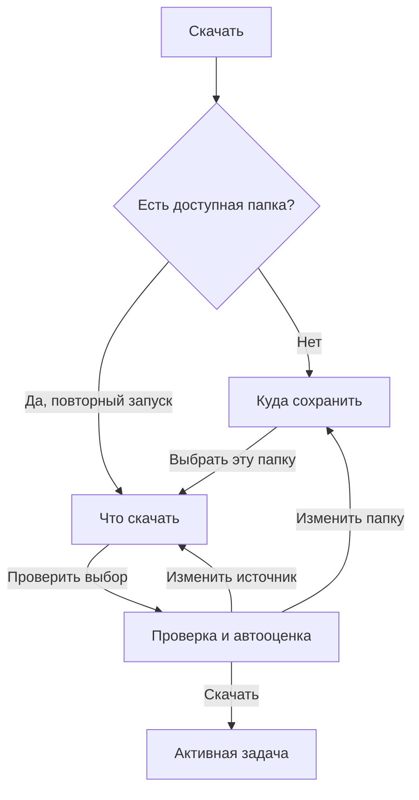

# Cloud Ferry · Аудит «Нового скачивания» и вариант v3

Аудит спецификации v2 и её 10 SVG-макетов. Серверный контракт и поведение работающего приложения здесь не проверялись. Ниже — предлагаемое поведение, тексты и условия его реализации.

## Что исправить в v2

| Где | Что мешает | Изменение |
|---|---|---|
| Шапка | «Шаг 2 из 3» и три полоски передают одно и то же. Нет общего названия операции | «Новое скачивание» один раз в шапке. В блоке шага — короткий заголовок и одно обозначение позиции «2 из 3». Убрать полоски |
| Назначение | Путь в панели и в футере, «На уровень выше» занимает место, а список не объясняет, что нажатием открывается папка | Один путь в навигации. Кнопка вверх со стрелкой и доступным именем, строки со стрелкой вправо. «Выбрать эту папку» подтверждает открытую папку |
| Источник | «Выбранные элементы» звучит так, будто это список уже выбранного. «Файлы» на каждой строке визуально спорит с именами | Обычный режим — выбор по списку. «Выбрать весь диск» в меню дополнительных действий. Просмотр файлов — компактная кнопка списка с подсказкой и доступным именем |
| Скачанное | Переключатель «Показать» одновременно меняет видимость и право выбора. Можно застрять на конфликте после его выключения | Отделить фильтр видимости от правил скачивания. Фильтр никогда не изменяет выбор или payload. Включение повторного скачивания — отдельное действие только при известном поведении сервера |
| Дерево | Галка родителя смешивает явный выбор всей папки и частичный выбор. Нажатие на смешанную галку может молча увеличить объём | Смешанное состояние показывает частичный выбор. Попытка выбрать всю ветку через смешанный чекбокс открывает компактное подтверждение «Выбрать всю папку?». Снять выбранную подпапку или файл можно на месте |
| Лимиты | Сообщение может потеряться среди строк. В v2 не описано, что произойдёт при замене родителя с уже выбранными потомками | После попытки превышения показать сообщение у футера и сохранить фокус. Проверять лимит на итоговом нормализованном выборе до применения изменения |
| Панель файлов | На мобильном «Назад» и «К папкам» ведут в разные места. «Показать ещё» нарисовано даже при неизвестной пагинации | В представлении файлов единственный возврат — «К папкам». Переход к проверке остаётся в футере. Подгрузку показывать при подтверждённом наличии следующей страницы |
| Сводка | Снова «Что скачать» и «Куда сохранить», лишняя подпись «Домашний сервер». Режим «Добавлять файлы» занимает отдельную карточку, хотя его нельзя менять | Две строки «Источник» и «Папка на сервере», по действию «Изменить» у каждой. Одно предложение о сохранности файлов как примечание рядом со стартом |
| Оценка | До 10 минут пользователь может ждать или повторять запрос. Частичный результат не даёт продолжить, даже если оценка сама по себе необязательна для сервера | Автоматическая фоновая оценка. Старт при неполных данных разрешать только при подтверждённой серверной защите. Для остальных случаев явно описать ожидание, ошибку и выход |
| После клика «Скачать» | При обрыве сети окно предлагает повтор, но существование задачи может быть неизвестно | Держать статус «Проверяем запуск…». Повторять с тем же ключом идемпотентности при поддержке API. Переходить к задаче только после подтверждения |
| Точность макетов | В разных SVG разный пример выбора, а сводка выглядит как продолжение того же сценария. Мобильный лимит показан рядом с несколькими отмеченными строками без признака, что остальной список прокручен | Использовать одинаковые данные на всех шагах. Для лимита явно показать прокрученное состояние списка. Проверять переносы на длинных именах и при увеличении текста |

## Предлагаемый флоу

Сохраняем порядок «Назначение → Источник → Проверка» для первого запуска. Назначение нужно для проверки скачанного, поэтому оно определяется до выбора источника. При следующем запуске можно подставить последнюю доступную папку, показать её в строке «Сохранить в» и начать с выбора источника. Если папка недоступна, возвращаемся к обычному первому шагу. Оба входа приводят к одной и той же проверке.

«Изменить папку» из проверки выполняет навигацию с возвратом к сверке. Если новое назначение влияет на выбранные позиции, открываем источник и показываем только затронутые элементы. Выбор не очищаем. Черновик живёт в рамках диалога. Подтверждение закрытия показываем при фактической потере ручного выбора, а не после просмотра папок или автооценки. Шаги сообщают позицию только в полном сценарии. При входе с сохранённой папкой показываем «Что скачать» и «Проверка» без перенумерации.

### 1 · Куда сохранить

- Вверху одна навигационная строка: кнопка вверх, текущий путь, действие «Создать папку». На телефоне путь переносится на отдельную строку. Полный путь доступен по фокусу и tap.
- Папки открываются нажатием строки. Разрешённая пустая папка — полноценное назначение, основная кнопка доступна. При виртуальном корне под путём появляется «Откройте папку на сервере».
- Футер содержит «Выбрать эту папку». При редактировании из проверки — «Сохранить папку». Свободное место здесь не показываем.
- При создании новой папки поле и действия находятся под навигацией. После успеха открываем её и сохраняем только после подтверждения.

### 2 · Что скачать

- В строке «Сохранить в» показываем компактный путь и «Изменить» только при сокращённом входе. При полном сценарии достаточно «Назад».
- Строка папки: раскрытие вложенных папок, чекбокс, имя и метаданные, кнопка просмотра файлов. Чекбокс и кнопка просмотра имеют разные доступные имена. На телефоне сохраняем привычную подпись «Файлы» у активной строки или в панели, кнопка в остальных строках остаётся доступна сразу.
- Размер и количество выводим только при наличии данных. Для уточняемой метрики после загрузки «Размер уточняется». Для скачанного элемента статус «Уже скачано» заменяет лишние метаданные. Неполный размер не выдаём за полный.
- Панель файлов сохраняет выбор при закрытии и подгрузке. На десктопе открывается сбоку, на телефоне на месте дерева. «К папкам» возвращает к исходной строке. В этом представлении футер содержит только основное действие. Пустая категория и ошибка показаны внутри панели.
- Все выбранные потомки исчезают из явного списка при подтверждении выбора целой папки, поскольку входят в неё. Сначала вычисляем итоговые значения лимитов. Если потомок был включён через выбор родителя, не разрешаем исключение, пока API не подтверждает поддержку исключений. Снять весь выбор родителя можно сразу.
- Границы — 20 явных корней папок, 100 отдельных файлов вне выбранных корней, если именно так считает API. При попытке 21/101: «Можно выбрать не больше 20 папок» / «Можно выбрать не больше 100 отдельных файлов». Пустой валидный выбор отключает «Проверить выбор». Достигнутый лимит оставляет кнопку доступной. Сообщение находится над футером, внутри его зарезервированной зоны, с переносом текста.
- «Выбрать весь диск» скрывается из основного ряда в меню «Ещё». Открытие меню никогда не переключает режим. После выбора меняем кнопку меню на видимый режим «Весь диск» и действие «Выбрать вручную». Используем этот вариант только при подтверждённом серверном режиме. До проверки контракта не заменяем его массовой отметкой первых 20 папок.
- Если сервер при добавлении пропускает существующие файлы, выбираем папки обычным способом. На проверке, где доступны реальные данные, показываем «Уже есть на сервере: N» только если N известно и больше нуля. «Показать уже скачанные» влияет только на видимость уже известных позиций. Если сервер может перезаписывать, уточняем правило отдельно до запуска, а обещание о сохранении существующих файлов формулируем по контракту.

### 3 · Проверка

| Элемент | Пример |
|---|---|
| Источник | «2 папки и 1 файл» · «Изменить» |
| Папка на сервере | `/downloads/Облако` · «Изменить» |
| К скачиванию | «179 файлов · 954,8 МБ» |
| Свободно | «18,2 ГБ» |
| Примечание | «Существующие файлы не удаляются» |
| Футер | «Назад» · «Скачать» |

Если проверка успешна, двух чисел достаточно. Дополнительный статус нужен при отклонении: «Не хватает 420 МБ» или «Часть файлов не удалось оценить». Раскрытие названий источника доступно по строке сводки; в коротком выборе можно перечислить до трёх названий рядом с количеством, если это помогает сверить одноимённые папки.

Оценка стартует на входе по тому же нормализованному выбору, который уйдёт на запуск. Изменение параметров отменяет ожидание старого ответа и привязывает новый результат к новой версии черновика. Если сервер умеет отменять расчёт, сообщаем ему об уходе. Порог 10 минут считаем таймаутом ожидания, а не обещанием отмены серверной работы.

| Оценка | Видимый текст | Действие |
|---|---|---|
| В процессе | «Считаем объём…» | Доступны изменения. После длительного ожидания «Оценка ещё идёт» |
| Готова, места достаточно | Объём и свободное место | «Скачать» |
| Места мало | «Не хватает {размер}» | «Изменить» у папки или источника |
| Частичная | «Учтено {размер}. У части файлов размер неизвестен» | «Повторить оценку» или защищённый старт по контракту |
| Ошибка или таймаут | «Не удалось оценить объём» | «Повторить оценку» или защищённый старт по контракту |
| Запуск | «Запускаем…» | Один запрос на одно действие |
| Ответ потерян | «Проверяем, началось ли скачивание…» | Сверяем состояние задачи по запросу или идентификатору операции |

Если сервер требует полной оценки, после таймаута предлагаем сократить выбор, сменить назначение или повторить оценку. Если сервер способен безопасно запускать задачу без точного объёма, основной сценарий допускает скачивание без ожидания полной оценки. Перед запуском явно показываем «Объём пока неизвестен». При подтверждённой нехватке места запуск заблокирован в обоих вариантах.

## После запуска

Карточка на главном экране продолжает тот же сценарий. Заголовок «Скачивание», одна строка назначения и прогресс. Проценты, скорость и остаток показываем только при наличии данных. При паузе оставляем прогресс и меняем действие на «Продолжить». По завершении «Готово» и фактическое число файлов. При частичном сбое — «Не скачалось: {N}» и действие «Повторить для {N} файлов». «Скопировать список ошибок» следует за раскрытием списка, где видны причины. При полном отказе показываем причину и доступное действие. Открытый диалог переводит фокус на карточку принятой задачи, только когда запуск подтверждён.

## Правила визуальной гармонизации

- Общий каркас v2 остаётся: диалог до 880 px, на 390 px во весь экран. Шапка и футер занимают отдельные строки, только тело прокручивается. На мобильном вложенная панель заменяет содержимое, а не открывает второй диалог.
- Одна основная синяя кнопка на каждом представлении. Возврат текстовой кнопкой со стрелкой, закрытие в шапке. «Создать папку», меню «Ещё» и «Изменить» рядом с объектом, к которому относятся.
- Один уровень деления контента: строки с тонким разделителем. Для короткой сводки использовать цельный блок без отдельного фона у каждого поля. В предупреждении — текст и условный статус, спокойная подложка только при реальной ошибке.
- «Шаг N из 3» и полоски заменить одним «N из 3». Убрать «Выберите одну папку…», «Домашний сервер», постоянный счётчик выбора и отдельную надпись «Места достаточно». Сохранить точные пути, объём, сроки ожидания по событию и формулировки, объясняющие блокировку.
- Проверить ширины 1440/1000/390, дополнительно 320 px и короткий экран. Действия остаются доступными при 200% текста. Сохраняем клавиатурный фокус после навигации и повторов. Лимит и итог оценки озвучиваем один раз, время и скорость не озвучиваем на каждом обновлении.

## План обсуждения и реализации

1. **Согласовать продуктовые решения.** Предлагаю сохранять порядок для первого запуска и использовать последнее назначение при повторном. Для существующих файлов предпочтение — пропуск, если действующий сервер это поддерживает. По оценке объёма решение зависит от возможности безопасного запуска без точного размера.
2. **Проверить API.** Пропуск и перезапись, дедупликация родителя с потомками, лимиты режима всего диска, файлы после первых 50, права и свободное место, безопасный повтор отправки. Сопоставить серверные коды с локальными действиями восстановления.
3. **P0 — сделать стабильный каркас и понятный выбор.** Устранить тупик, разделить фильтр и политику, добавить выбор файлов, автопроверку и явные состояния старта. Если лимит срабатывает, из этого состояния должны работать «Назад», «Проверить выбор», «Закрыть» и снятие выбора.
4. **P1 — ускорить повторные скачивания.** Последнее назначение, восстановление раскрытия и прокрутки, подгрузка файлов, если поддерживается.
5. **P2 — улучшить длинные сценарии.** Поиск по файлам при поддержке API и запуск без ожидания оценки при подтверждённой защите. Отслеживать долю завершённых запусков, время от открытия до старта, частоту лимитов и выходы во время расчёта. Содержимое путей и имена файлов в события не включать.
